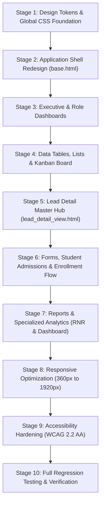

# TECHPANDA CRM: COMPREHENSIVE UI/UX TRANSFORMATION IMPLEMENTATION PLAN

**Strategy:** Incremental, non-destructive, full-stack visual transformation  
**Constraint:** Strict frontend-only execution (preserve backend views, URLs, permissions, models, migrations, forms, and business logic)  
**Target Quality:** Commercially competitive enterprise SaaS design (Linear / Stripe / Datadog aesthetic)

---

## 1. Phased Execution Roadmap

---

## 2. Stage Breakdown & Deliverables

### Stage 1: Design Tokens & Global CSS Foundation
- **Files Modified:** `static/css/design-system.css`, `static/css/crm.css`
- **Actions:**
  - Harmonize all CSS custom properties into a unified design token system (`--tp-*` tokens with legacy aliases for `--primary`, `--bg-body`, etc.).
  - Establish a shared typographic scale with tabular numbers (`tnum`) for quantitative figures.
  - Standardize button variants (`.btn-primary`, `.btn-secondary`, `.btn-warning`, `.btn-danger`, `.btn-icon`) with smooth hover depressions and 3px focus rings.
  - Implement universal input, select, and textarea styles with consistent 38px height and accessible focus outlines.
  - Standardize semantic status badges (New, Contacted, Interested, Follow-up, Demo Scheduled, Visited, Counseling, Joined, Lost).

### Stage 2: Application Shell Redesign (`templates/base.html`)
- **Files Modified:** `templates/base.html`, `static/css/design-system.css`, `static/js/crm.js`
- **Actions:**
  - **Modernized Sidebar**:
    - Clean brand header with SVG icon logo and crisp typography.
    - Role-based navigation grouping with subtle section labels, icon alignment, active pill indicators, and keyboard-operable accordion headers.
    - Smooth mobile drawer transition with backdrop tap dismissal.
  - **Refined Application Header**:
    - Compact desktop height (56px) with clean alignment.
    - Global quick search pill button with keyboard shortcut badge (`Ctrl + K`).
    - Integrated Admin Branch Switcher dropdown with custom chevron.
    - Dark/Light Theme toggle button with smooth icon rotation.
    - Notifications bell with live unread badge and dropdown menu.
    - User avatar badge with role indicator and profile/logout popover.

### Stage 3: Executive & Role Dashboards Redesign
- **Files Modified:**
  - `templates/admin_dashboard/dashboard.html`
  - `templates/manager_dashboard/dashboard.html`
  - `templates/branch_head_dashboard/dashboard.html`
  - `templates/counselor_dashboard/dashboard.html`
  - `templates/telecaller_dashboard/dashboard.html`
  - `templates/receptionist/dashboard.html`
- **Actions:**
  - Replace cluttered inline-styled grids with structured, responsive layout grids.
  - Standardize KPI cards with category color accents, trend badges, and hover lifts.
  - Optimize the filter toolbar across dashboards (presets for Today / Week / Month / All Time, compact inline date pickers).
  - Clean up performance tables and recent activity streams with avatar badges, readable timestamps, and status pills.

### Stage 4: Data Tables, Lists & Kanban Board
- **Files Modified:**
  - `templates/admin/leads_list.html`
  - `templates/counselor/leads_list.html`
  - `templates/telecaller/leads_list.html`
  - `templates/leads/kanban.html`
  - `templates/partials/pagination.html`
  - `static/css/design-system.css`
- **Actions:**
  - Modernize table headers with uppercase caption labels, clear sort indicators, and sticky positioning.
  - Implement responsive mobile card transformation for table rows when viewport is under 768px.
  - Style the floating bulk actions toolbar that surfaces when multiple rows are checked.
  - Polish the Kanban board columns with status count badges, smooth card drag previews, and accessible keyboard move fallbacks.
  - Upgrade pagination component with touch-friendly 36px buttons and clear active indicators.

### Stage 5: Lead Detail Master Hub Redesign
- **Files Modified:** `templates/leads/lead_detail_view.html`, `static/css/lead-details-modern.css`
- **Actions:**
  - Organize the 69KB centerpiece screen into clean visual hierarchy:
    - Sticky top summary header: Lead name, contact numbers with click-to-call, status dropdown, auto-save status indicator, primary action CTA.
    - 3-column desktop layout (Profile info & auto-save inputs | Call history & timeline | Follow-up scheduler & admissions).
    - Polished activity timeline with caller avatars, duration pills, call outcome chips, and inline audio player.
    - Seamless WhatsApp drawer integration with template triggers.

### Stage 6: Forms, Student Admissions & Enrollment Flow
- **Files Modified:**
  - `templates/leads/enrollment_form.html`
  - `templates/leads/enrolled_students.html`
  - `templates/leads/receipt.html`
  - `templates/admin/lead_create.html`
  - `templates/admin/lead_setup.html`
- **Actions:**
  - Redesign student enrollment checkout form into a structured, confidence-inspiring financial workflow with live GST computation and installment table preview.
  - Polish the printable and downloadable student payment receipt.
  - Enhance the `/admin/settings/lead-setup/` source allocation tabs, percentage sum meter, and expected leads distribution table.

### Stage 7: Reports & Specialized Analytics
- **Files Modified:**
  - `templates/reports/telecaller_rnr_report.html`
  - `templates/reports/dashboard_report.html`
  - `templates/reports/admin_reports.html`
  - `templates/calls/recordings_list.html`
  - `templates/calls/missed_calls_list.html`
- **Actions:**
  - Polish Telecaller RNR report KPI cards and ensure seamless interaction with the slide-over lead history drilldown drawer.
  - Synchronize Chart.js palettes with dark/light themes.
  - Enhance missed calls queue with urgent countdown timers and 1-click callback buttons.
  - Polish the audio recordings list with custom audio player controls and waveform visualization.

### Stage 8: Authentication & Account Pages
- **Files Modified:**
  - `templates/registration/login.html`
  - `templates/registration/admin_login.html`
  - `templates/registration/manager_login.html`
  - `templates/registration/telecaller_login.html`
  - `templates/registration/account_setup.html`
  - `templates/registration/password_reset_form.html`
  - `templates/registration/password_reset_confirm.html`
- **Actions:**
  - Unified modern split-screen authentication layout.
  - Real-time password security checklist with live validation requirements.
  - Clear error alerts and security reassurance badges.

### Stage 9: Responsive Optimization & Mobile Ergonomics
- **Breakpoints Tested:** `360px` (Compact Mobile), `390px` (Standard iPhone), `768px` (iPad Portrait), `1024px` (Tablet/Laptop), `1440px` (Desktop).
- **Actions:**
  - Ensure zero horizontal page overflow (`overflow-x: hidden` on app containers).
  - Ensure all touch targets are at least 36px–44px.
  - Modal and drawer dialogs adjust smoothly to full screen or bottom sheets on small screens.

### Stage 10: Accessibility (WCAG 2.2 AA) & Regression Testing
- **Actions:**
  - Verify contrast ratios on all text and badge elements.
  - Ensure full keyboard operability (Tab, Enter, Space, Esc) across all modals, dropdowns, and drawers.
  - Execute existing automated Django test suites (`accounts`, `leads`, `chat`, `reports`) to confirm 100% test pass rate and zero regressions.
