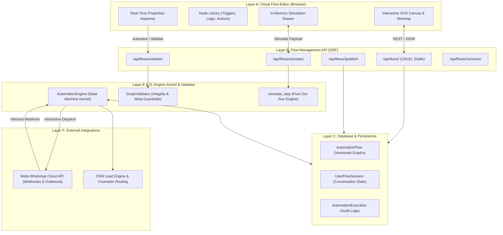

# WhatsApp Automation Flow Builder — Current Architecture Documentation

## 1. System Overview & Technology Stack

The WhatsApp Automation Flow Builder is an enterprise-grade visual workflow platform integrated into the CRM application. It enables administrators and counselors to design, validate, simulate, publish, and execute multi-turn interactive conversational flows over the WhatsApp Business Cloud API.

### Core Technology Stack
- **Backend Framework**: Python 3.13, Django 5.1.x, Django REST Framework (DRF)
- **Real-Time Communication**: Django Channels 4.x with ASGI Redis/InMemory layer
- **Database**: MySQL 8.x (`crmlive` production/dev database) with UTF-8mb4 character set; SQLite fallback for isolated unit testing
- **Frontend Architecture**: Server-rendered Django Templates (`flow_builder.html`), vanilla ES6+ JavaScript (`flow_builder.js`), and custom responsive CSS3 design system (`flow_builder.css`)
- **Messaging Adapter**: Official Meta WhatsApp Cloud API via `CRM/chat/whatsapp/` client
- **CRM Integration**: Native Lead intake, course attribution, telecaller assignment, and activity logging via `CRM/chat/crm.py`

---

## 2. Layered Architecture

---

## 3. Database Models & Schema Design

### 3.1 `AutomationFlow` (`chat_automationflow`)
Stores visual graph definitions and version metadata:
- `id` (BigInt PK): Unique flow identifier.
- `business_account_id` (FK): Associated WhatsApp Business Account (or null for global fallback).
- `name` (CharField): Flow display name (e.g., "Digipanda Admissions").
- `slug` (SlugField): Normalized URL slug.
- `version` (PositiveInteger): Monotonically increasing version counter.
- `status` (CharField): `draft` vs `published`.
- `trigger_type` (CharField): `first_incoming_message`, `keyword`, `button_reply`, `list_reply`, `always_on`.
- `trigger_keywords` (TextField): Comma-separated trigger keywords (e.g., "hi, hello, course, restart").
- `flow_data` (JSONField): Complete graph snapshot containing `nodes`, `connections`, and `viewport` metadata.
- `is_active` (BooleanField): Whether the flow participates in live event routing.
- `published_at` (DateTimeField): Timestamp when the version was locked and activated.

### 3.2 `UserFlowSession` (`chat_userflowsession`)
Tracks runtime customer progress through a flow:
- `conversation_id` (FK): Active chat conversation.
- `flow_id` (FK): The automation flow currently being executed.
- `flow_version` (PositiveInteger): Locked version number pinned at session start.
- `current_node_id` (CharField): Active node pointer (e.g., `node_buttons_0908`).
- `waiting_for_input` (BooleanField): Whether execution is paused waiting for user action.
- `status` (CharField): `active`, `paused`, `handed_over`, `completed`, `expired`.
- `collected_data` (JSONField): Variables gathered across steps (e.g., `{"interest_type": "Training"}`).

### 3.3 `AutomationExecution` (`chat_automationexecution`)
Detailed audit log of every state transition:
- `session_id`, `flow_id`, `flow_version`, `node_id`.
- `event_type`: e.g., `TRIGGER_STARTED`, `NODE_EXECUTED`, `BUTTON_SELECTED`, `LIST_SELECTED`, `LEAD_UPDATED`, `FLOW_COMPLETED`.
- `input_data`, `output_data`: Sanitized JSON payloads.
- `error`: Error messages or exceptions encountered.

---

## 4. Frontend Component Breakdown

1. **Toolbar (`.builder-toolbar`)**: Flow title, status badge, save draft button, validation pill, test simulator launcher, export/import JSON, and publish modal trigger.
2. **Left Sidebar (`.builder-sidebar-left`)**: Categorized palette containing Triggers, Messages, Interactive Buttons, List Menus, Questions, Logic/Conditions, Actions, and Handover nodes.
3. **Canvas Viewport (`.canvas-viewport`)**: Infinite pan/zoom canvas, interactive SVG bezier connection lines with animated directional markers, dynamic port connectors, and visual node cards.
4. **Properties Inspector (`.builder-sidebar-right`)**: Contextual properties editor reacting to node selection with live validation, variable binding, button editor, and list row editor.
5. **Interactive Simulator (`#simDrawer`)**: In-memory test environment simulating phone chat bubbles, interactive buttons, and list pickers without calling Meta API or mutating production CRM data.

---

## 5. Webhook Ingestion & Execution Flow

1. Customer sends WhatsApp message $\rightarrow$ Meta dispatches webhook to `/webhook/whatsapp/`.
2. Webhook verification checks token authenticity and deduplicates via `Message.whatsapp_message_id`.
3. Customer phone number is resolved to a `Conversation` and linked to an existing or new `Lead` via `ensure_lead_for_conversation`.
4. `AutomationEngine.process_incoming` resolves active session:
   - If `active`: Resumes current waiting node.
   - If `handed_over`: Bot remains silent (human agent in control).
   - If `completed` / `expired` / `no session`: Evaluates trigger criteria and initiates a new session if keywords match.
5. Interactive responses (`button_reply`, `list_reply`) or text inputs advance to the next connected node.
6. Collected data is synchronized to the Lead record via `crm.sync_answers`.
7. Once an `end` node is reached, final message is dispatched and session is marked `completed`.
