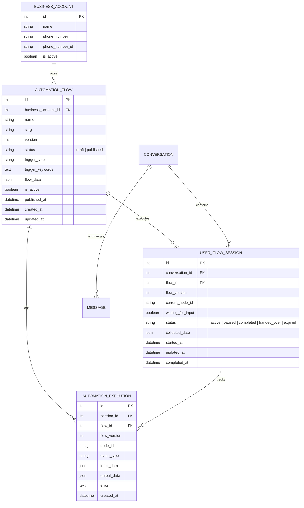

# WhatsApp Automation Flow Builder — Database Schema & Data Dictionary

## 1. Schema Architecture & Entity Relationship

---

## 2. Model Specifications

### 2.1 `AutomationFlow` Table (`chat_automationflow`)
| Column | Type | Constraints | Description |
| :--- | :--- | :--- | :--- |
| `id` | BigInt | PK, Auto Increment | Primary identifier. |
| `business_account_id` | Int | FK, Nullable, Index | WhatsApp Business Account owner. Null = global fallback. |
| `name` | Varchar(128) | NOT NULL | User-visible flow title (e.g. "Digipanda Admissions"). |
| `slug` | Varchar(128) | Blank allowed | URL slug for clean lookups. |
| `version` | PositiveInt | Default 1 | Monotonically increasing version counter. |
| `status` | Varchar(16) | Default 'published' | State machine: `draft` or `published`. |
| `trigger_type` | Varchar(32) | Default 'first_incoming_message' | Trigger trigger mechanism (`first_incoming_message`, `keyword`, `button_reply`, `list_reply`, `always_on`). |
| `trigger_keywords` | Text | NOT NULL | Normalized comma-separated trigger keywords (e.g., "hi, hello, course, restart"). |
| `flow_data` | JSON | NOT NULL | Complete graph JSON structure containing `nodes`, `connections`, and `viewport`. |
| `is_active` | Boolean | Default True, Index | Active routing status. |
| `published_at` | DateTime | Nullable | Timestamp when published and locked. |
| `created_at` | DateTime | Auto now add | Flow creation timestamp. |
| `updated_at` | DateTime | Auto now | Last updated timestamp. |

### 2.2 `UserFlowSession` Table (`chat_userflowsession`)
| Column | Type | Constraints | Description |
| :--- | :--- | :--- | :--- |
| `id` | BigInt | PK, Auto Increment | Session record identifier. |
| `conversation_id` | Int | FK, NOT NULL, Index | Linked chat conversation with student. |
| `flow_id` | Int | FK, NOT NULL, Index | Associated AutomationFlow. |
| `flow_version` | PositiveInt | Default 1 | Snapshot version locked at session inception. |
| `current_node_id` | Varchar(64) | Default 'trigger_1' | Node pointer representing current location in flow graph. |
| `waiting_for_input` | Boolean | Default False | Paused waiting for customer action. |
| `status` | Varchar(20) | Default 'active', Index | Status enum: `active`, `paused`, `handed_over`, `completed`, `expired`. |
| `collected_data` | JSON | NOT NULL | Key-value dictionary of student responses and extracted variables. |
| `started_at` | DateTime | Auto now add | Session initiation timestamp. |
| `updated_at` | DateTime | Auto now | Last activity timestamp. |
| `completed_at` | DateTime | Nullable | Terminal completion timestamp. |

### 2.3 `AutomationExecution` Table (`chat_automationexecution`)
| Column | Type | Constraints | Description |
| :--- | :--- | :--- | :--- |
| `id` | BigInt | PK, Auto Increment | Log entry identifier. |
| `session_id` | Int | FK, Nullable, Index | Linked UserFlowSession. |
| `flow_id` | Int | FK, Nullable, Index | Associated AutomationFlow. |
| `flow_version` | PositiveInt | Default 1 | Active flow version during execution. |
| `node_id` | Varchar(64) | Index | Identifier of the node being executed. |
| `event_type` | Varchar(64) | Index | Event type identifier (`TRIGGER_STARTED`, `NODE_EXECUTED`, `BUTTON_SELECTED`, `LIST_SELECTED`, `LEAD_UPDATED`, `FLOW_COMPLETED`). |
| `input_data` | JSON | Default dict | Sanitized incoming payload or customer input. |
| `output_data` | JSON | Default dict | Dispatched message metadata or branch results. |
| `error` | Text | Blank allowed | Error traceback or validation rejection reason. |
| `created_at` | DateTime | Auto now add, Index | Audit log timestamp. |

---

## 3. Data Integrity & Migration Strategy
1. **Referential Integrity**: Cascading deletes on conversations safely clean up transient sessions; flows preserve executions with `SET_NULL` for historical auditability.
2. **Character Set**: Full `utf8mb4` support guarantees emoji safety (`👋`, `🚀`, `✨`, `💙`) in messages and flow data.
3. **Draft Immutability**: Modifying an active published flow automatically enforces draft forking or rejection to ensure in-flight customer sessions never break.
