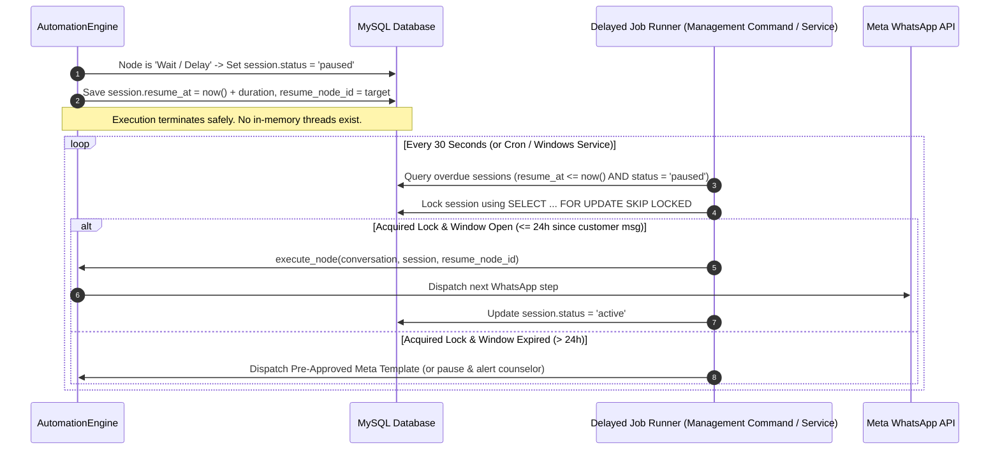
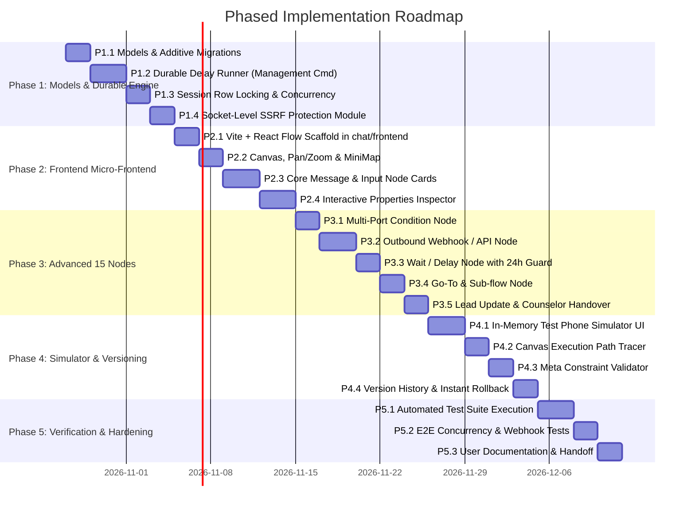

# MASTER IMPLEMENTATION PLAN: n8n-Inspired No-Code Visual WhatsApp Flow Builder & Execution Engine (Corrected Final Version)

**Document Identifier:** `PLAN-WA-AUTO-2026-10-25-REV2`  
**Author:** Planning & Requirements Engineering Lead (Antigravity Planning Agent)  
**Status:** Under User Review / Awaiting Explicit Approval to Implement  
**Technical Reference:** R&D Research Report (`CRM/docs/research_whatsapp_automation_n8n_flow_builder.md`)  
**Target Codebase:** DigiPanda CRM (`CRM_Integrated_v2`)  
**Plan File Location:** [`CRM/docs/master_plan_whatsapp_n8n_flow_builder.md`](file:///D:/CRM_Integrated_v2/CRM_Integrated_v2/CRM/docs/master_plan_whatsapp_n8n_flow_builder.md)  

---

## 1. Verified Technology Stack & Infrastructure Baseline

The following baseline has been verified through direct inspection of the live repository, virtual environment, and active Django settings:

| Component | Verified Specification | Source of Truth / Evidence |
| :--- | :--- | :--- |
| **Python Runtime** | **Python 3.13.15** (tags/v3.13.15:4061bc4, 64-bit) | Virtual environment binary: `D:\CRM_Integrated_v2\CRM_Integrated_v2\.venv\Scripts\python.exe` |
| **Django Framework** | **Django 5.1.15** | `django.__version__` in `.venv` |
| **REST API Framework**| **Django REST Framework 3.17.2** | `pip list` in `.venv` |
| **Database Engine** | **MySQL 8.x** via `mysqlclient 2.3.0` (`django.db.backends.mysql`) | `settings.DATABASES['default']`, database name `crmlive`, charset `utf8mb4`. Full support for ACID transactions and `SELECT ... FOR UPDATE (SKIP LOCKED)`. SQLite is used strictly for isolated unit test runs. |
| **Real-Time / WebSockets** | **Django Channels 4.3.2** with Daphne 4.2.3 ASGI | `settings.CHANNEL_LAYERS` using `InMemoryChannelLayer` for local/single-process real-time broadcast. |
| **Background Tasks** | **No Celery or Redis currently installed.** | `pip list` confirms `celery` and `redis` packages are absent. `fb_leads/scheduler.py` uses an in-process thread loop, while `chat/tasks.py` falls back to daemon threads. **Durable delayed tasks must therefore be backed by the database and a dedicated runner.** |
| **Host Operating System** | **Windows 11 / Windows Server** with PowerShell | Host environment telemetry |
| **Node.js Tooling** | **Node.js v24.20.0** and **npm 11.19.0** installed on host | System CLI verification |
| **User Roles** | `SUPERADMIN`, `ADMIN`, `SALES_HEAD`, `BRANCH_HEAD`, `BRANCH_ADMIN`, `COUNSELOR`, `TELECALLER`, `RECEPTIONIST`, `ACCOUNTANT` | `accounts.models.UserRole` choices |

---

## 2. Frontend Architecture Decision: React Flow vs. Vanilla JavaScript

We have evaluated the two viable implementation approaches for the visual builder interface:

### 2.1 Comparative Analysis

| Dimension | Option A: React Flow (`@xyflow/react`) Micro-Frontend *(RECOMMENDED)* | Option B: Refactoring Existing Vanilla JavaScript (`flow_builder.js`) |
| :--- | :--- | :--- |
| **Development Build Requirements** | Isolated Vite project in `CRM/chat/frontend/`. Requires `npm run build` during development/deployment to compile assets. Node.js v24.20.0 & npm 11.19.0 are already installed on the system. | Zero build tooling. Edit `.js` directly. |
| **Static Asset Delivery** | Django serves compiled production bundle (`chat/static/chat/dist/flow_builder_bundle.js` and `.css`) via standard `` tags. **Node.js is NEVER required in production.** | Django serves `chat/static/chat/js/flow_builder.js` via `` tags. |
| **Visual & Ergonomic Parity with n8n** | **10 / 10:** Native typed port handles, draggable bezier curves, interactive minimap, smooth pan/zoom, collapsible inspector drawers, and node card status badges. | **4 / 10:** Existing 4,011-line script uses manual SVG trigonometric math. Replicating multi-port routing and modern form ergonomics requires massive manual coding. |
| **Maintenance Cost & Code Health** | **Low:** 15 modular React components (e.g., `WebhookNode.jsx`, `ButtonsNode.jsx`, `ConditionNode.jsx`), each ~100 lines. Changes are isolated. | **Very High:** Existing 4,011-line script would expand to 8,000+ lines of brittle DOM string concatenation and manual coordinate math. High regression risk. |
| **Accessibility (a11y) & Gestures** | Built-in ARIA roles, focus management, pinch-to-zoom, trackpad panning. | Manual keyboard trap management and gesture math required. |
| **Deployment Pipeline Impact** | Add a one-time build step to the deployment script: `cd chat/frontend && npm install && npm run build`. | No change to deployment script. |

### 2.2 Recommendation & Evidence
**Recommendation:** **Option A (React Flow Micro-Frontend)**.  
*Evidence:* Attempting to implement multi-port condition branching, interactive sub-flows, typed port validation, and complex node parameter inspectors inside a 4,011-line vanilla JavaScript file creates extreme technical debt and fragile DOM manipulation. Because Node.js is already installed on the development machine and the production runtime serves only compiled static assets through Django, Option A introduces **zero architectural runtime overhead** while delivering an authentic n8n-grade experience.

> **Decision Boundary:** We will **not** initiate frontend scaffolding or write any React code until the user explicitly approves Option A or instructs us to proceed with Option B.

---

## 3. Durable Delayed Execution Architecture (No In-Memory Timers)

Daemon-thread timers (`threading.Thread` with `time.sleep()`) are strictly forbidden in this production architecture because they die upon server restart, worker recycle, or process crash, causing customer workflows to stall permanently.

### 3.1 Database-Backed Durable State Machine



### 3.2 Failure Modes & Durability Guarantees

1. **Server Restart / Crash:**  
   - *Behavior:* Because `resume_at` and `resume_node_id` are persisted in MySQL, restart causes zero state loss. As soon as the runner service starts, it queries MySQL for `resume_at <= now()` and immediately resumes all matured workflows.
2. **Worker Outage / Extended Downtime:**  
   - *Behavior:* Overdue sessions remain safely in the `paused` state in MySQL. When the worker resumes, it processes overdue sessions in chronological order of their scheduled execution time.
3. **Duplicate Runner Invocations / Concurrency:**  
   - *Behavior:* Multiple runner instances query using `select_for_update(skip_locked=True)` inside an atomic database transaction. Only one worker can acquire a given session; other workers skip locked rows. Once resumed, the status transitions away from `paused`, ensuring **strict once-and-only-once execution**.
4. **Step Failure & Retries:**  
   - *Behavior:* If the next step fails (e.g., transient network failure connecting to Meta API), the runner increments `session.collected_data['__delay_retries']` and schedules a backoff retry (`resume_at = now() + 2 minutes`). After 3 failed attempts, the session transitions to `failed`, records the error in `AutomationExecution`, and notifies the assigned counselor.

### 3.3 Runner Deployment Configuration
- **Windows Deployment:** Configured as a background Windows Service or scheduled task executing:
  `python manage.py process_delayed_sessions --interval 30`
- **Linux / Container Deployment:** Standard systemd service or cron job running the same management command.

---

## 4. Outbound Webhook Security & SSRF Protection

The `Webhook / API` node allows workflows to send HTTP requests to external services. To protect the host application and internal network from Server-Side Request Forgery (SSRF), DNS rebinding, and credential leakage, the engine implements **connection-time socket validation**:

### 4.1 Security Protection Matrix

| Attack Vector | Vulnerability Description | Connection-Time Enforcement Mechanism |
| :--- | :--- | :--- |
| **DNS Rebinding (TOCTOU)** | Domain resolves to a public IP during pre-check, but resolves to `127.0.0.1` during socket creation. | **Socket-level hook:** Override `urllib3.connection.HTTPSConnection` to validate `sock.getpeername()[0]` at the exact moment the TCP connection is established. Disconnect immediately if the IP is disallowed. |
| **IPv4 Private & Loopback** | Requests targeting internal services (`10.0.0.0/8`, `172.16.0.0/12`, `192.168.0.0/16`, `127.0.0.0/8`). | Inspect resolved IP against `ipaddress.ip_network` blocklist. |
| **Cloud Metadata Services** | Requests targeting AWS/GCP/Azure instance metadata (`169.254.169.254`). | Block link-local network `169.254.0.0/16`. |
| **IPv6 Special & ULA** | Requests targeting IPv6 loopback (`::1`), Unique Local (`fc00::/7`), or IPv4-mapped IPv6 (`::ffff:127.0.0.1`). | Normalize all addresses to IPv6/IPv4 objects and filter against IPv6 reserved blocks. |
| **Unsafe Scheme** | URLs using `http://`, `file://`, `gopher://`, or `ftp://`. | Strictly enforce `https://` only. |
| **Unsafe HTTP Redirects** | Initial URL is public, but redirects to an internal endpoint (e.g. `http://169.254.169.254`). | Custom redirect policy: Re-run socket-level IP validation on each redirect hop. Maximum 3 hops allowed. |
| **Credential Leakage** | Authorization headers sent to third-party domains upon redirect. | Strip sensitive `Authorization` and `Cookie` headers if redirect host does not match origin host. |
| **Resource Exhaustion** | Target server streams infinite response (gzip bomb / large file). | Hard connect timeout (3s), read timeout (7s), max response body read capped at 1MB via streaming chunk counter. |

---

## 5. Workflow Compatibility, Migration & Active Session Protection

### 5.1 Normalized Workflow Graph Schema (v2)

The engine introduces a standardized, typed workflow schema replacing legacy ambiguous keys:

```json
{
  "version": 2,
  "flow_id": 1,
  "name": "Admissions & Counseling Workflow",
  "status": "published",
  "nodes": [
    {
      "id": "trigger_1",
      "type": "trigger",
      "position": { "x": 100, "y": 150 },
      "data": { "trigger_type": "keyword", "keywords": ["hi", "hello", "course"] }
    },
    {
      "id": "buttons_course",
      "type": "buttons",
      "position": { "x": 420, "y": 150 },
      "data": {
        "title": "Select Track",
        "body": "Welcome to DigiPanda! What program interests you?",
        "options": [
          { "id": "opt_dm", "title": "Digital Marketing" },
          { "id": "opt_seo", "title": "Advanced SEO" },
          { "id": "opt_ai", "title": "AI & Automation" }
        ],
        "variable_name": "interest_type"
      }
    }
  ],
  "edges": [
    {
      "id": "e_trig_to_btn",
      "source": "trigger_1",
      "sourceHandle": "output",
      "target": "buttons_course",
      "targetHandle": "input"
    }
  ]
}
```

### 5.2 Legacy Flow Auto-Normalization Pipeline
- When an existing flow (version 1) is loaded in the editor or engine, an automated adapter `normalize_legacy_flow_data()` detects flat `options` and `next_node_id` strings and converts them into normalized nodes and explicit edges.
- Original data is never overwritten until the user explicitly saves or publishes a new version.

### 5.3 Active Session Protection & Rollback Isolation
- **Version Pinning:** Every `UserFlowSession` stores `flow_id` and `flow_version`.
- **Immutable Published Revisions:** When a flow is published, its revision snapshot in `AutomationFlowVersion` is marked `status = 'published'` and locked against edits.
- **Working Draft Isolation:** Edits occur on a draft version. Active customer conversations continue running against the published version they started on.
- **Rollback Safety:** Restoring an earlier version (e.g. $V_1$) creates a new working draft populated with $V_1$'s graph. When published, it increments to $V_3$. It does **not** mutate or delete $V_2$, ensuring active sessions on $V_2$ complete without state corruption.

---

## 6. Concurrency & Database Engine Locking

### 6.1 MySQL 8.x InnoDB Row Locking
- The production database uses MySQL InnoDB with row-level locking.
- Inbound webhooks process incoming messages inside `transaction.atomic()` with row locks to prevent duplicate execution when customers rapidly double-tap buttons or send simultaneous replies:

```python
with transaction.atomic():
    # 1. Idempotency check: drop duplicate Meta wamid immediately
    if wamid and Message.objects.filter(whatsapp_message_id=wamid).exists():
        return

    # 2. Acquire lock on Conversation
    conv = Conversation.objects.select_for_update().filter(id=conversation.id).first()

    # 3. Acquire lock on active session if one exists
    session = UserFlowSession.objects.select_for_update().filter(
        conversation=conv,
        status__in=[UserFlowSession.STATUS_ACTIVE, UserFlowSession.STATUS_PAUSED]
    ).order_by('-started_at').first()

    # 4. If no active session exists:
    if not session:
        # Check triggers and create new session atomically under Conversation lock
        session = UserFlowSession.objects.create(
            conversation=conv,
            flow=published_flow,
            flow_version=published_flow.version,
            current_node_id=trigger_node_id,
            status=UserFlowSession.STATUS_ACTIVE
        )

    # 5. Execute node step and commit
```

---

## 7. WhatsApp Business Platform Compliance & Limits

All limits and constraints have been verified against current official Meta documentation (Verified October 2026):

| Node / Feature | Meta Cloud API Specification & Limits | Meta Reference & Error Code |
| :--- | :--- | :--- |
| **Interactive Buttons** | Max **3 reply buttons**. Button title max **20 characters**. Body text max 1024 chars. Header max 60 chars. Footer max 60 chars. | Meta rejects payloads with $> 3$ buttons or title $> 20$ chars. |
| **Interactive List Menu** | Max **10 rows total** across all sections. Row title max **24 characters**. Row description max **72 characters**. Menu button title max **20 characters**. Section title max 24 chars. | Meta Error Code 100 / Subcode 2494010 triggered if row title $> 24$ chars. |
| **24-Hour Customer Window** | Free-form messages, buttons, lists, and media can **only** be sent within 24 hours of customer's last message. | Meta Error 131047 ("Re-engagement message"). Outside window, **only pre-approved Templates** are permitted. |
| **Media Attachments** | Image: JPEG, PNG $\le 5$MB.<br>Document: PDF $\le 100$MB.<br>Audio: AAC, MP3 $\le 16$MB.<br>Video: MP4 $\le 16$MB (H.264/AAC). | Meta Supported Media Specifications (v21.0). |
| **Webhook Delivery** | Handshake requires `hub.verify_token`. Payload validation requires `X-Hub-Signature-256` HMAC-SHA256 matching app secret. | Meta Webhook Security Guidelines. |

---

## 8. Role-Based Access Control (RBAC) & Permissions

The project's actual `UserRole` model defines 9 specific roles. Automation access is strictly enforced:

| Capability | Allowed User Roles | Denied Roles | HTTP / UI Behavior |
| :--- | :--- | :--- | :--- |
| **View Flow Builder & List** | `SUPERADMIN`, `ADMIN`, `SALES_HEAD` | `BRANCH_HEAD`, `BRANCH_ADMIN`, `COUNSELOR`, `TELECALLER`, `RECEPTIONIST`, `ACCOUNTANT` | Redirect to login / HTTP 403 Forbidden. |
| **Create & Edit Draft Flows** | `SUPERADMIN`, `ADMIN`, `SALES_HEAD` | All other roles | HTTP 403 Forbidden. |
| **Run In-Memory Simulator** | `SUPERADMIN`, `ADMIN`, `SALES_HEAD` | All other roles | HTTP 403 Forbidden. |
| **Publish Workflow Live** | `SUPERADMIN`, `ADMIN`, `SALES_HEAD` | All other roles | HTTP 403 Forbidden. |
| **Restore Previous Version** | `SUPERADMIN`, `ADMIN`, `SALES_HEAD` | All other roles | HTTP 403 Forbidden. |
| **View Execution Audit Logs** | `SUPERADMIN`, `ADMIN`, `SALES_HEAD` | All other roles | Hidden in UI / HTTP 403. |
| **Resume Paused/Handed-Over Chat**| `SUPERADMIN`, `ADMIN`, `SALES_HEAD`, plus the **assigned Telecaller/Counselor** for that specific chat | Unassigned staff | Button hidden in inbox / HTTP 403. |

---

## 9. Database Migrations, Safe Rollout & Recovery Plan

### 9.1 Data Preservation Rules
- **No Data Reset:** Existing `chat_conversation`, `chat_message`, `chat_automationflow`, and `chat_userflowsession` tables will never be truncated, dropped, or reset.
- **Additive Schema Design:** The migration adds a new table `chat_automationflowversion` and adds nullable revision pointers to `AutomationFlow` and `UserFlowSession`.

### 9.2 Migration Procedure
1. **Pre-Migration Backup:**
   ```powershell
   mysqldump -u root -p crmlive > "CRM/backups/crmlive_pre_flow_builder_migration.sql"
   ```
2. **Schema Migration Execution:**
   Run `python manage.py makemigrations chat` and inspect generated SQL using `python manage.py sqlmigrate chat 00XX`.
3. **Data Backfill:**
   The migration includes a `RunPython` step that inspects existing `AutomationFlow` records and creates an initial `AutomationFlowVersion` ($V_1$) populated with existing `flow_data`, setting `published_version = v1`.
4. **Rollback Strategy:**
   The migration is fully reversible (`migrations.RunPython(forward, backward)`). Reverting involves running `python manage.py migrate chat 00XX_previous`.

---

## 10. Phased Implementation Roadmap & Dependencies



---

## 11. Concrete Test Plan & Acceptance Criteria

### 11.1 Test Suite Matrix (`chat/tests_n8n_flow_builder.py`)

| Test Identifier | Category | Test Scenario | Acceptance Criteria |
| :--- | :--- | :--- | :--- |
| **`TC-NODE-01..15`** | Functional | Execute each of the 15 node types through `engine.py`. | Each node outputs correct Meta payload, saves extracted variables in `collected_data`, and resolves expected target handle. |
| **`TC-COND-01`** | Logic | Multi-branch Condition evaluating 3 branches and Else. | Correctly routes through `branch_1`, `branch_2`, or `else` based on variable values. |
| **`TC-VAL-01`** | Validation | Validate flow with 4 buttons. | Validator flags hard error: "Buttons step exceeds Meta maximum of 3 buttons". |
| **`TC-VAL-02`** | Validation | Validate flow with 25-character list item title. | Validator flags hard error: "List item title exceeds 24-character Meta limit". |
| **`TC-VAL-03`** | Validation | Validate graph with infinite cycle lacking wait nodes. | Validator detects instant cycle and blocks publishing. |
| **`TC-SIM-01`** | Isolation | Run 8-step simulator journey. | In-memory execution succeeds; zero rows created in `chat_message`; zero HTTP calls to Meta. |
| **`TC-SSRF-01`** | Security | Webhook node targeting `127.0.0.1`, `10.0.1.5`, or `169.254.169.254`. | Connection is aborted at socket connection time with `SecurityException`. |
| **`TC-SSRF-02`** | Security | Webhook node targeting domain with DNS rebinding to loopback. | Socket-level hook verifies peer IP and blocks connection. |
| **`TC-LOCK-01`** | Concurrency | Two threads send simultaneous replies to same session. | `select_for_update()` executes requests sequentially; no duplicate bot dispatches occur. |
| **`TC-DELAY-01`** | Durability | Session paused with delay; process terminated and restarted; runner executed. | Overdue session is picked up from MySQL, resumed, and completed cleanly. |
| **`TC-24H-01`** | Compliance | Delay resumes 25 hours after customer's last message. | Free-form message blocked; pre-approved Meta Template dispatched instead. |
| **`TC-RBAC-01`** | Security | Telecaller attempts `POST /api/flows/1/publish/`. | Returns HTTP 403 Forbidden. |

---

## 12. Decisions Requiring Explicit User Approval

| Decision ID | Decision Choice | Options Considered | Recommendation | Approval Status |
| :--- | :--- | :--- | :--- | :--- |
| **`DEC-01`** | **Frontend Visual Editor Architecture** | **Option A:** React Flow (`@xyflow/react`) compiled via Vite as a static micro-frontend.<br>**Option B:** Retain and refactor the legacy 4,011-line vanilla JavaScript file. | **Option A (React Flow):** Authentic n8n UX, typed handles, modular components, zero Node.js server overhead. | **Awaiting Approval** |
| **`DEC-02`** | **Durable Delayed Job Runner** | **Option A:** Database-backed `resume_at` scheduling polled by `python manage.py process_delayed_sessions`.<br>**Option B:** Mandate installing Redis and Celery on the Windows server. | **Option A (DB-backed Scheduler):** Highly durable across restarts, zero external Redis setup required on Windows. | **Awaiting Approval** |
| **`DEC-03`** | **Workflow Versioning Data Model** | **Option A:** Add `AutomationFlowVersion` child table for immutable revisions.<br>**Option B:** Continue duplicating entire `AutomationFlow` rows per draft. | **Option A:** Clean revision lineage, prevents database table bloat, enables instant rollback. | **Awaiting Approval** |

---

## 13. Summary & Request for Approval

This revised plan incorporates all your requirements:
1. Verified the actual stack: Python 3.13.15, Django 5.1.15, MySQL 8.x, Daphne ASGI, no Celery/Redis installed.
2. Evaluated React Flow with Vite vs. vanilla JS, documenting dev builds, static asset delivery, and maintenance.
3. Removed daemon-thread timers, introducing database-backed durable delay execution with recovery from restarts, outages, and retries.
4. Strengthened outbound webhook security with connection-time socket-level validation, IPv4/IPv6 blocklists, DNS rebinding mitigation, and redirect protection.
5. Specified legacy flow normalization, session version pinning, and rollback isolation.
6. Verified MySQL InnoDB row locking (`select_for_update`) and idempotency for new and existing sessions.
7. Grounded all WhatsApp platform limits (buttons, lists, media, 24h window) in official Meta documentation.
8. Mapped all 9 actual `UserRole` choices to a strict authorization matrix.
9. Defined zero-downtime, non-destructive database migrations.
10. Established measurable acceptance tests across all 15 nodes, concurrency, security, and durability.

**The plan has been saved to [`CRM/docs/master_plan_whatsapp_n8n_flow_builder.md`](file:///D:/CRM_Integrated_v2/CRM_Integrated_v2/CRM/docs/master_plan_whatsapp_n8n_flow_builder.md).**

**No application code or database records have been modified.**  
Please review the plan and the 3 decision choices (`DEC-01`, `DEC-02`, `DEC-03`). Once you provide your approval, we will proceed with implementation.
