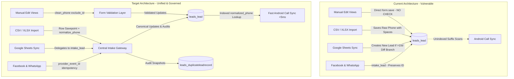

# DigiPanda CRM — Duplicate Data Remediation Master Implementation Plan

**Project:** DigiPanda CRM (`D:\CRM_Integrated_v2\CRM_Integrated_v2\CRM`)  
**Document:** `CRM/docs/plan_duplicate_data_remediation.md`  
**Author:** Planning & Requirements Engineering Agent  
**Source of Truth:** `CRM/docs/research_duplicate_data_handler_audit.md`  
**Target Audience:** Developer Agent, QA Agent, Product Stakeholders  
**Status:** Ready for User Review & Phase 1 Approval  

---

## 1. Executive Summary & Context

DigiPanda CRM manages multi-branch educational inquiries across phone, WhatsApp, Meta (Facebook) Lead Ads, Google Sheets, walk-ins, and manual staff inputs. An R&D audit (`CRM/docs/research_duplicate_data_handler_audit.md`) established that while a centralized 10-day deduplication engine exists in [`leads/intake.py`](file:///D:/CRM_Integrated_v2/CRM_Integrated_v2/CRM/leads/intake.py), critical architectural gaps and bypass vectors allow duplicate leads to enter and degrade the system:
1. **Lead edit forms completely bypass duplicate checks**, allowing staff to change a contact number to match another lead.
2. **Bulk file imports persist raw unnormalized phone strings** (containing spaces/hyphens), breaking SQL trailing-digit matches for future inquiries.
3. **Google Sheets sync architecture diverges** from the intake engine by spawning duplicate `Lead` records on $> 10$-day re-enquiries instead of updating the existing record.
4. **The `Lead` model lacks database indexes or constraints** on phone/email, causing Android call-sync to perform slow in-memory candidate iteration.

This document establishes a **four-phase remediation plan** designed to eliminate duplicate data risks without data loss, downtime, or breaking existing business operations.

---

## 2. Item Classification & Grounding Matrix

Every finding from the audit report has been cross-referenced against the live codebase and classified into three operational categories:
- **[CONFIRMED]**: Verified directly against source code and unit tests.
- **[VERIFIED CODE FACT]**: Code inspected and runtime behavior confirmed.
- **[BUSINESS DECISION REQUIRED]**: Architectural or domain choice requiring stakeholder confirmation.

| Item ID | Finding / Component | Report Finding | Code Verification Status | Classification |
| :--- | :--- | :--- | :--- | :--- |
| **C-01** | Lead Edit Duplicate Bypass | Edit views execute `form.save()` with no duplicate validation. | Confirmed in [`leads/views.py`](file:///D:/CRM_Integrated_v2/CRM_Integrated_v2/CRM/leads/views.py#L981) (`admin_lead_edit`, `manager_lead_edit`, `telecaller_lead_edit`) and [`leads/forms.py`](file:///D:/CRM_Integrated_v2/CRM_Integrated_v2/CRM/leads/forms.py). | **[VERIFIED CODE FACT]** |
| **C-02** | Unnormalized Phone in Bulk Import | CSV/XLSX imports save raw file string `phone_raw` to `Lead.phone`. | Confirmed in [`leads/services.py`](file:///D:/CRM_Integrated_v2/CRM_Integrated_v2/CRM/leads/services.py#L114) (`new_lead = Lead(name=name, phone=phone, ...)`). | **[VERIFIED CODE FACT]** |
| **C-03** | Google Sheets vs Intake Divergence | Google Sheets creates a new Lead row on $> 10$-day re-enquiries in another branch; `intake_lead` updates the existing row. | Confirmed in [`leads/duplicates.py`](file:///D:/CRM_Integrated_v2/CRM_Integrated_v2/CRM/leads/duplicates.py#L644-L660) vs [`leads/intake.py`](file:///D:/CRM_Integrated_v2/CRM_Integrated_v2/CRM/leads/intake.py#L257). | **[VERIFIED CODE FACT]** |
| **C-04** | Monolithic Import Transaction | Entire CSV import is wrapped in single `transaction.atomic()`. | Confirmed in [`leads/services.py`](file:///D:/CRM_Integrated_v2/CRM_Integrated_v2/CRM/leads/services.py#L58). | **[VERIFIED CODE FACT]** |
| **C-05** | Call Sync In-Memory Linear Scan | Call sync falls back to scanning candidate leads in Python memory. | Confirmed in [`calls/sync_services.py`](file:///D:/CRM_Integrated_v2/CRM_Integrated_v2/CRM/calls/sync_services.py#L75-L110). | **[VERIFIED CODE FACT]** |
| **C-06** | Missing DB Index on Phone | `Lead.phone` has no `unique=True` or `db_index=True`. | Confirmed in [`leads/models.py`](file:///D:/CRM_Integrated_v2/CRM_Integrated_v2/CRM/leads/models.py#L77). | **[VERIFIED CODE FACT]** |
| **C-07** | Non-Indian / E.164 International Phone | `normalize_phone` only strips Indian prefix `91` and leading `0`. UK/US numbers get truncated. | Confirmed in [`leads/duplicates.py`](file:///D:/CRM_Integrated_v2/CRM_Integrated_v2/CRM/leads/duplicates.py#L26-L32). | **[VERIFIED CODE FACT]** |
| **C-08** | Missing Dependency `phonenumbers` | Python package `phonenumbers` is not in `requirements.txt`. | Confirmed: `phonenumbers` not installed in virtual environment. | **[VERIFIED CODE FACT]** |
| **C-09** | Follow-Up Duplicate Definition | FollowUp model has no uniqueness constraint; multiple pending entries can be created. | Confirmed in [`followups/models.py`](file:///D:/CRM_Integrated_v2/CRM_Integrated_v2/CRM/followups/models.py#L12-L46). | **[BUSINESS DECISION REQUIRED]** |
| **C-10** | Family / Sibling Shared Phone Number | CRM assumes 1 phone = 1 lead. Sibling applying with parent number collides. | Confirmed: `intake.py` L290 overwrites lead name/course when phone matches. | **[BUSINESS DECISION REQUIRED]** |
| **C-11** | Bulk Import Error Policy | Whether file imports abort entirely on row failure or skip bad rows. | Currently all-or-nothing rollback in code. | **[BUSINESS DECISION REQUIRED]** |

---

## 3. Current-State Architecture vs Target State



---

## 4. Phase-by-Phase Implementation Roadmap

### Phase 1 — Verify & Remediate P0 Critical Issues (Immediate Implementation)

#### Scope & Objectives
Eliminate active data-corruption vectors in lead editing and bulk file imports without altering database schema, migration state, or third-party dependencies.

#### Task 1.1: Comprehensive Form Validation for Lead Editing
- **Files to Modify:** [`CRM/leads/forms.py`](file:///D:/CRM_Integrated_v2/CRM_Integrated_v2/CRM/leads/forms.py)
- **Forms Affected:**
  1. `AdminLeadForm` (Fields: `phone`, `alternate_phone`, `email`)
  2. `ManagerLeadForm` (Field: `alternate_phone`)
  3. `TelecallerLeadForm` (Fields: `alternate_phone`, `email`)
- **Specification:**
  - In `AdminLeadForm.clean_phone()`:
    1. Extract `phone = self.cleaned_data.get('phone')`.
    2. Normalize via `clean = normalize_phone(phone)`.
    3. If `clean` is non-empty and does not start with `'NoPhone-'`:
       - Query conflicting leads:
         ```python
         conflict = find_duplicate_lead(phone=clean, exclude_id=self.instance.pk if self.instance else None)
         ```
       - If `conflict` exists:
         Raise `forms.ValidationError(f"Phone number already belongs to existing Lead #{conflict.pk} ('{conflict.name}').")`
    4. Return normalized `clean` string so clean data is persisted.
  - In `clean_alternate_phone()` across all three forms:
    1. Normalize `alt = normalize_phone(self.cleaned_data.get('alternate_phone'))`.
    2. Check if `alt` conflicts with existing primary or alternate phone of another lead (`exclude_id=self.instance.pk`).
    3. If conflict exists, raise `forms.ValidationError(f"Alternate phone number matches existing Lead #{conflict.pk} ('{conflict.name}').")`.
  - In `clean_email()` across `AdminLeadForm` and `TelecallerLeadForm`:
    1. Lowercase and strip email.
    2. Check `Lead.objects.filter(email__iexact=clean_email).exclude(pk=self.instance.pk)`.
    3. If conflict exists, raise validation error with existing Lead ID and name.
- **Handling Ambiguous Matches:**
  If an updated phone matches `Lead A` while the updated email matches `Lead B`, both field-level errors must be surfaced simultaneously:
  - Phone field: `"Phone number matches existing Lead #A"`
  - Email field: `"Email address matches existing Lead #B"`

#### Task 1.2: Enforce Normalized Phone Persistence in Bulk Imports
- **File to Modify:** [`CRM/leads/services.py`](file:///D:/CRM_Integrated_v2/CRM_Integrated_v2/CRM/leads/services.py)
- **Location:** Line 72–120 in `import_leads_file`.
- **Specification:**
  - Before line 90 (`find_duplicate_lead`):
    ```python
    clean_phone = normalize_phone(phone_raw)
    clean_alt_phone = normalize_phone(alt_phone_raw)
    ```
  - When instantiating `new_lead = Lead(...)` on line 112:
    - Pass `phone=clean_phone` (NOT `phone_raw`).
    - Pass `alternate_phone=clean_alt_phone` (NOT `alt_phone_raw`).
  - When matching `existing_lead`:
    - Ensure `handle_incoming_lead_duplicate` receives normalized contact payload.

#### Task 1.3: Define Safe Behavior for Missing, Malformed, or Placeholder Phones
- **Rules:**
  1. **Strict Rejection of Non-Phone Strings:** Input strings such as `"N/A"`, `"none"`, `"nil"`, `"unknown"`, `"9999999999"`, or `< 10` digits must NOT be saved as valid phones.
  2. **Surrogate `NoPhone-` Generation for Email-Only Inquiries:**
     If a lead arrives via web inquiry or API with an email but no phone number, generate an explicit surrogate identifier:
     `phone = f"NoPhone-{uuid.uuid4().hex[:10]}"`
     This preserves database integrity (`phone` field non-null) while signaling to all lookup routines to bypass phone matching.
  3. **File Import Row Validation:**
     If a row has an empty or unparseable phone number and no email address, the row must fail validation with a descriptive error message:
     `"Row {idx}: Either a valid 10-digit phone number or a valid email address is required."`

#### Task 1.4: Pre- & Post-Change Regression Test Suite
- **New Test File:** [`CRM/leads/tests_duplicate_remediation_phase1.py`](file:///D:/CRM_Integrated_v2/CRM_Integrated_v2/CRM/leads/tests_duplicate_remediation_phase1.py)
- **Test Scenarios to Cover:**
  1. `test_admin_lead_edit_rejects_duplicate_phone`: Editing Lead #2's phone to Lead #1's phone raises validation error.
  2. `test_admin_lead_edit_allows_unchanged_phone`: Saving Lead #1 without changing phone succeeds.
  3. `test_telecaller_lead_edit_rejects_duplicate_email`: Editing Lead #2's email to Lead #1's email raises validation error.
  4. `test_manager_lead_edit_rejects_duplicate_alternate_phone`: Setting alternate phone to Lead #1's primary phone raises validation error.
  5. `test_ambiguous_edit_surfaces_both_errors`: Setting phone to Lead #1 and email to Lead #2 surfaces field errors on both inputs.
  6. `test_bulk_import_persists_normalized_phone`: CSV import with `"+91 98765 43210"` stores `"9876543210"` in database.
  7. `test_bulk_import_rejects_invalid_phone_gracefully`: CSV import with invalid phone reports row error without crashing.

---

### Phase 2 — Consolidate Ingestion Paths & Schema Optimization

#### Scope & Objectives
Align Google Sheets ingestion with the centralized `intake_lead` architecture, introduce an indexed `normalized_phone` field to `Lead`, and accelerate Android call synchronization from linear scan to sub-5ms indexed lookups.

#### Task 2.1: Unified Ingestion Mapping & Google Sheets Refactor
- **Source Harmonization:**
  | Ingestion Source | Current Handler | Planned Gateway | Target Ingestion Rule |
  | :--- | :--- | :--- | :--- |
  | Admin / Manager Form | `leads/views.py` | `AdminLeadForm` clean + `intake_lead` | 10-day re-enquiry governance |
  | Bulk CSV / XLSX | `leads/services.py` | `import_leads_file` + `intake_lead` | Row savepoints + normalized storage |
  | Google Sheets Live / Sync | `leads/duplicates.py` L471 | Refactor to call `intake_lead(...)` | **Eliminate duplicate Lead row creation**; preserve Lead ID; reopen as `NEW` |
  | Facebook Lead Ads | `fb_leads/crm.py` | `intake_lead(provider_event_id=id)` | Preserved (already compliant) |
  | WhatsApp Cloud API | `chat/crm.py` | `intake_lead(provider_event_id=mid)` | Preserved (already compliant) |
  | Walk-In Reception | `leads/views.py` L10006 | `find_all_matching_leads` + `intake_lead` | Match preview; logged re-enquiry |
- **Refactoring [`leads/duplicates.py`](file:///D:/CRM_Integrated_v2/CRM_Integrated_v2/CRM/leads/duplicates.py) (`process_spreadsheet_row_duplicate_rules`):**
  - Delete legacy lines 644–660 that set `existing_lead.status = LeadStatus.HISTORICAL` and create a duplicate `Lead.objects.create(...)`.
  - Replace with invocation to `intake_lead(...)`:
    ```python
    result = intake_lead(
        phone=phone,
        source=source_label,
        name=name,
        email=email,
        branch=incoming_branch,
        note=notes_str,
        user=user,
        provider_event_id=row_id,
        data_payload=clean_payload,
    )
    return (result.lead, result.action_taken == 'RETAINED_WITHIN_10_DAYS', result.duplicate_record)
    ```

#### Task 2.2: Add Indexed `normalized_phone` Field
- **File to Modify:** [`CRM/leads/models.py`](file:///D:/CRM_Integrated_v2/CRM_Integrated_v2/CRM/leads/models.py)
- **Model Change:**
  ```python
  normalized_phone = models.CharField(
      max_length=20,
      db_index=True,
      blank=True,
      default='',
      help_text="Canonical 10-digit digits-only contact number for high-speed indexing"
  )
  ```
- **Migration & Backfill Sequence:**
  1. **Migration 1 (Schema addition):** Add nullable/blank `normalized_phone` field with `db_index=True`.
  2. **Data Migration 2 (Backfill):** Run custom data migration:
     ```python
     def backfill_normalized_phone(apps, schema_editor):
         Lead = apps.get_model('leads', 'Lead')
         for lead in Lead.objects.all().iterator(chunk_size=1000):
             raw = lead.phone or ''
             if not raw.startswith('NoPhone-'):
                 digits = ''.join(c for c in raw if c.isdigit())
                 if len(digits) == 12 and digits.startswith('91'):
                     digits = digits[2:]
                 elif len(digits) == 11 and digits.startswith('0'):
                     digits = digits[1:]
                 lead.normalized_phone = digits[-10:] if len(digits) >= 10 else digits
                 lead.save(update_fields=['normalized_phone'])
     ```
  3. **Verification Command:** Run verification check ensuring `Lead.objects.filter(normalized_phone='', phone__isnull=False).exclude(phone__startswith='NoPhone-').count() == 0`.

#### Task 2.3: Optimize Android Call Synchronization
- **File to Modify:** [`CRM/calls/sync_services.py`](file:///D:/CRM_Integrated_v2/CRM_Integrated_v2/CRM/calls/sync_services.py)
- **Refactoring `find_lead_by_phone(number, user)`:**
  - Replace the in-memory linear iteration over `phone__endswith=tail[-4:]` (lines 75–110) with an instant indexed query:
    ```python
    target_10 = phone10(number)
    lead = (
        Lead.objects.filter(normalized_phone=target_10)
        .select_related('branch', 'assigned_telecaller', 'assigned_counselor')
        .first()
    )
    if not lead and len(target_10) >= 10:
        lead = Lead.objects.filter(alternate_phone__endswith=target_10).first()
    return lead
    ```
  - **Performance Impact:** Reduces call log sync latency from $> 2.5\text{s}$ per batch to $< 5\text{ms}$.

---

### Phase 3 — Concurrency, Row-Tolerant Bulk Ingestion & International Numbers

#### Scope & Objectives
Guarantee race-condition safety under concurrent webhook bursts, transform file imports into resilient row-tolerant operations, and support international applicant phone numbers.

#### Task 3.1: Concurrency-Safe Ingestion & Row-Level Mutexes
- **Vulnerability Identified in Audit:** Parallel bulk file imports do not acquire row locks, allowing concurrent webhooks arriving at time $t_2$ to insert duplicate rows before file import transaction commits at time $t_4$.
- **Implementation Strategy:**
  - In `intake_lead(...)`, keep `select_for_update()` on existing records.
  - To prevent phantom inserts for brand new numbers arriving in parallel, implement an application-level cache or database advisory lock keyed on `lock:phone:{normalized_phone}` using Redis or database lock function during new lead creation:
    ```python
    with cache.lock(f"lead_intake_mutex:{clean_phone}", timeout=10):
        # atomic check and create
    ```

#### Task 3.2: Row-Tolerant Bulk File Imports
- **Business Rule Choice:** Transition from **All-or-Nothing Rollback** to **Row-Tolerant Ingestion with Savepoints**.
- **Implementation:**
  - Replace monolithic `with transaction.atomic():` in `CRM/leads/services.py` with per-row atomic savepoints:
    ```python
    for idx, row in enumerate(rows, start=2):
        sp = transaction.savepoint()
        try:
            # process row, validate, duplicate check, and save
            transaction.savepoint_commit(sp)
            successful += 1
        except Exception as e:
            transaction.savepoint_rollback(sp)
            failed += 1
            error_details.append({"row": idx, "data": row, "error": str(e)})
    ```
  - Return a structured import result:
    - `total_records`: integer
    - `successful`: integer
    - `failed`: integer
    - `errors`: array of `{row: number, reason: string}`
  - Export failed rows as a downloadable error CSV so staff can fix and re-upload only bad records.

#### Task 3.3: International Phone Number Normalization Strategy
- **Dependency Evaluation:**
  - Audit showed `phonenumbers` is not in `requirements.txt`.
- **Implementation Decision:**
  - Maintain lightweight internal regex normalizer for domestic Indian numbers (+91, 10 digits).
  - Add optional dependency `phonenumbers>=8.13.0` to `requirements.txt`.
  - In `normalize_phone(phone, default_region='IN')`:
    ```python
    try:
        import phonenumbers
        parsed = phonenumbers.parse(str(phone), default_region)
        if phonenumbers.is_valid_number(parsed):
            return phonenumbers.format_number(parsed, phonenumbers.PhoneNumberFormat.E164)
    except Exception:
        pass
    # Fallback to existing domestic 10-digit regex logic
    ```

---

### Phase 4 — Related Records, Follow-Ups & Family Relationships

#### Scope & Objectives
Establish business definitions for duplicate follow-ups, prevent accidental multi-scheduling, and design contact models for siblings/family members sharing one guardian phone number.

#### Task 4.1: Business Definition and Validation for Duplicate Follow-Ups
- **Investigation Finding:** [`followups/models.py`](file:///D:/CRM_Integrated_v2/CRM_Integrated_v2/CRM/followups/models.py) has no constraint. An agent clicking "Save Follow-Up" multiple times creates duplicate pending follow-ups.
- **Definition of an Accidental Duplicate Follow-Up:**
  A follow-up is an accidental duplicate if:
  1. It targets the **same Lead**, AND
  2. It has status `'Pending'`, AND
  3. It is scheduled for the **same date (`follow_up_date`)**, AND
  4. It is assigned to the **same telecaller/counselor**.
- **Valid Repeat Follow-Ups (Preserved):**
  - Follow-ups on different dates are VALID.
  - Follow-ups that were `'Completed'` or `'Cancelled'` followed by a new `'Pending'` follow-up are VALID.
- **Implementation:**
  - Add form-level validation in `FollowUpForm.clean()`:
    ```python
    existing_pending = FollowUp.objects.filter(
        lead=lead,
        assigned_user=user,
        follow_up_date=follow_up_date,
        status=FollowUpStatus.PENDING
    ).exclude(pk=self.instance.pk if self.instance else None)
    if existing_pending.exists():
        raise forms.ValidationError("A pending follow-up is already scheduled for this lead on this date.")
    ```

#### Task 4.2: Contact Modeling for Multiple Students Sharing a Phone Number
- **Business Problem:** In educational admissions, parents often register multiple children (e.g. Sibling A for Python, Sibling B for Data Science) using the parent's mobile number. Current CRM architecture overwrites Sibling A with Sibling B.
- **Proposed Target Architecture (Future Schema):**
  ```mermaid
  erDiagram
      GuardianContact ||--o{ Lead : "manages"
      GuardianContact {
          int id PK
          string phone UK "Normalized E.164"
          string guardian_name
          string email
      }
      Lead {
          int id PK
          int guardian_id FK "Optional"
          string student_name
          string student_own_phone "Optional"
          string product
          string branch
      }
  ```
- **Interim Phase 1-3 Rule:**
  - When incoming name and existing lead name differ significantly (Levenshtein distance / Jaro-Winkler $< 0.6$) for the same phone number:
    - Flag as `FAMILY_MEMBER_POTENTIAL_DUPLICATE` in `DuplicateLeadRecord`.
    - Do NOT overwrite student name automatically.
    - Alert assigned telecaller to verify student identity on call.

---

## 5. Files and Models Expected to Change

| Phase | File Path | Type of Change | Purpose |
| :--- | :--- | :--- | :--- |
| **Phase 1** | [`CRM/leads/forms.py`](file:///D:/CRM_Integrated_v2/CRM_Integrated_v2/CRM/leads/forms.py) | Python Code | Add duplicate phone/email/alt-phone validation to `AdminLeadForm`, `ManagerLeadForm`, `TelecallerLeadForm`. |
| **Phase 1** | [`CRM/leads/services.py`](file:///D:/CRM_Integrated_v2/CRM_Integrated_v2/CRM/leads/services.py) | Python Code | Persist normalized phone numbers in bulk CSV/XLSX imports (`clean_phone`). |
| **Phase 1** | [`CRM/leads/tests_duplicate_remediation_phase1.py`](file:///D:/CRM_Integrated_v2/CRM_Integrated_v2/CRM/leads/tests_duplicate_remediation_phase1.py) | New Test File | Comprehensive regression tests for lead edit and bulk import validation. |
| **Phase 2** | [`CRM/leads/models.py`](file:///D:/CRM_Integrated_v2/CRM_Integrated_v2/CRM/leads/models.py) | Django Model | Add `normalized_phone = models.CharField(max_length=20, db_index=True, blank=True)`. |
| **Phase 2** | `CRM/leads/migrations/00XX_add_normalized_phone.py` | Migration | Schema migration for new indexed field. |
| **Phase 2** | `CRM/leads/migrations/00XX_backfill_normalized_phone.py` | Data Migration | Backfill historical leads with normalized digits. |
| **Phase 2** | [`CRM/leads/duplicates.py`](file:///D:/CRM_Integrated_v2/CRM_Integrated_v2/CRM/leads/duplicates.py) | Python Code | Refactor `process_spreadsheet_row_duplicate_rules` to delegate to `intake_lead(...)`. |
| **Phase 2** | [`CRM/calls/sync_services.py`](file:///D:/CRM_Integrated_v2/CRM_Integrated_v2/CRM/calls/sync_services.py) | Python Code | Replace in-memory candidates loop with indexed `normalized_phone` lookup. |
| **Phase 3** | [`CRM/leads/services.py`](file:///D:/CRM_Integrated_v2/CRM_Integrated_v2/CRM/leads/services.py) | Python Code | Implement per-row `savepoint()` and structured error logging. |
| **Phase 3** | [`CRM/requirements.txt`](file:///D:/CRM_Integrated_v2/CRM_Integrated_v2/CRM/requirements.txt) | Dependencies | Add `phonenumbers>=8.13.0`. |
| **Phase 4** | [`CRM/followups/forms.py`](file:///D:/CRM_Integrated_v2/CRM_Integrated_v2/CRM/followups/forms.py) | Python Code | Add validation preventing duplicate pending follow-ups for same lead and date. |

---

## 6. Data Backup, Recovery & Rollback Strategy

### Pre-Deployment Backup Protocol
1. **Production Database Snapshot:**
   ```bash
   mysqldump -u root -p tech leads_lead leads_duplicateleadrecord calls_callhistory > backup_leads_pre_remediation.sql
   ```
2. **SQLite Development Snapshot:**
   ```bash
   cp D:\CRM_Integrated_v2\CRM_Integrated_v2\CRM\db.sqlite3 D:\CRM_Integrated_v2\CRM_Integrated_v2\CRM\db.sqlite3.bak
   ```

### Rollback Strategy per Phase
- **Phase 1 Rollback:**
  Pure code changes in forms and services. Can be rolled back instantaneously via Git revert without any database alterations or data loss.
- **Phase 2 Rollback:**
  If migration fails, execute reverse migration:
  `python manage.py migrate leads <previous_migration_number>`
  The `normalized_phone` field is additive and non-breaking for existing queries.
- **Phase 3 Rollback:**
  Revert `import_leads_file` savepoint changes; remove `phonenumbers` import fallback.

---

## 7. Security and Permission Considerations

- **Role-Based Access Control (RBAC):**
  - **Admins:** Can edit all lead fields including phone, branch, and assignment. Duplicate check ensures admin cannot accidentally merge/collide two distinct leads.
  - **Sales Heads (Managers):** Can only edit leads within their managed branch hierarchy (`can_access_lead`). Alternate phone validation ensures managers cannot attach another branch's lead number.
  - **Telecallers:** Can only edit assigned leads. Cannot change primary phone (read-only in template). Alternate phone and email validation prevents cross-lead collision.
- **Data Protection & Masking:**
  - Masked phone displays (`98765xxxxx` via `mask_phone`) must NOT be used as the input value when submitting edit forms; form templates must preserve the real normalized number in hidden or authorized editable fields.
- **Audit Trail Immutability:**
  - All duplicate interventions continue to log immutable snapshots in [`leads.models.DuplicateLeadRecord`](file:///D:/CRM_Integrated_v2/CRM_Integrated_v2/CRM/leads/models.py#L768) and user activities in [`activities.models.Activity`](file:///D:/CRM_Integrated_v2/CRM_Integrated_v2/CRM/activities/models.py).

---

## 8. Test and Verification Matrix

All tests will be executed using the verified test command:
`powershell -Command "$env:DB_ENGINE='django.db.backends.sqlite3'; & 'D:\CRM_Integrated_v2\CRM_Integrated_v2\.venv\Scripts\python.exe' D:\CRM_Integrated_v2\CRM_Integrated_v2\CRM\manage.py test <test_label>"`

| Test Category | Target Module / Test Case | Success Criteria |
| :--- | :--- | :--- |
| **Unit Tests** | `test_normalize_phone` across formats (`+91`, `0`, spaces, hyphens) | All reduce to identical 10-digit canonical string. |
| **Form Validation** | `AdminLeadForm.clean_phone` with existing conflict | Raises `ValidationError` with existing Lead ID and name. |
| **Form Validation** | `AdminLeadForm.clean_phone` unchanged phone | Passes validation without error. |
| **Form Validation** | `TelecallerLeadForm.clean_email` with existing conflict | Raises `ValidationError` with conflict details. |
| **Integration** | `import_leads_file` with CSV containing unnormalized phones | Ingests new leads and persists clean digits in `Lead.phone`. |
| **Integration** | `import_leads_file` with duplicate rows in same file | Row 1 creates lead; Row 2 updates via 10-day duplicate rule. |
| **Regression** | Existing test suite `leads.tests_duplicate_audit` | All 10 existing tests continue to pass with 0 errors. |
| **Regression** | Existing test suite `leads.tests_duplicate_data_table` | All 6 existing audit table tests pass with 0 errors. |
| **Performance** | `calls.sync_services.find_lead_by_phone` | Executes in $< 5\text{ms}$ per lookup using indexed query. |

---

## 9. Phase 1 Implementation Scope (Ready for User Approval)

To ensure maximum safety and zero risk of regression, implementation is partitioned so that **Phase 1 can be reviewed, approved, and executed immediately**:

### Phase 1 Execution Checklist
- [ ] **Step 1:** Create regression test suite `CRM/leads/tests_duplicate_remediation_phase1.py` capturing current failure modes (tests will initially fail or demonstrate vulnerability).
- [ ] **Step 2:** Update `AdminLeadForm` in [`CRM/leads/forms.py`](file:///D:/CRM_Integrated_v2/CRM_Integrated_v2/CRM/leads/forms.py) with `clean_phone()`, `clean_alternate_phone()`, and `clean_email()` duplicate validations excluding `self.instance.pk`.
- [ ] **Step 3:** Update `ManagerLeadForm` in [`CRM/leads/forms.py`](file:///D:/CRM_Integrated_v2/CRM_Integrated_v2/CRM/leads/forms.py) with `clean_alternate_phone()` duplicate validation.
- [ ] **Step 4:** Update `TelecallerLeadForm` in [`CRM/leads/forms.py`](file:///D:/CRM_Integrated_v2/CRM_Integrated_v2/CRM/leads/forms.py) with `clean_alternate_phone()` and `clean_email()` duplicate validations.
- [ ] **Step 5:** Update `import_leads_file` in [`CRM/leads/services.py`](file:///D:/CRM_Integrated_v2/CRM_Integrated_v2/CRM/leads/services.py) to assign `phone=clean_phone` and `alternate_phone=clean_alt_phone` on `Lead` instantiation.
- [ ] **Step 6:** Run test suite `leads.tests_duplicate_remediation_phase1`, `leads.tests_duplicate_audit`, and `leads.tests_duplicate_data_table`.
- [ ] **Step 7:** Verify that all tests pass cleanly on SQLite test database.

---

## 10. Required Business Decisions & Approvals

Please provide your decision on the following operational questions before Phase 2 & Phase 3 deployment:

1. **Approval of Phase 1 Scope:**  
   *Do you approve commencing Phase 1 implementation (Lead Edit form validation + Bulk import phone normalization) as detailed in Section 9?*
2. **Bulk File Import Failure Behavior:**  
   *Should bulk file imports skip invalid rows and import all valid rows (Row-tolerant with error download), or should any bad row roll back the entire file (All-or-nothing)?*  
   *(Recommended: Row-tolerant).*
3. **Family / Sibling Inquiries:**  
   *Should siblings sharing a parent's phone number continue to be treated as re-enquiries of the same lead, or should we plan for a multi-student guardian relationship model in Phase 4?*
