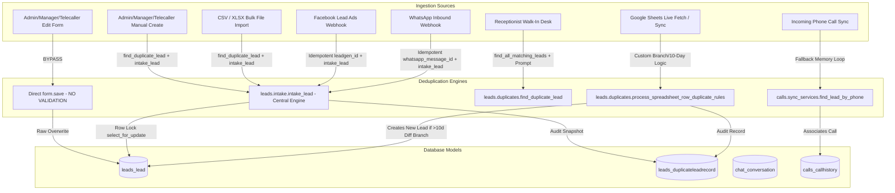
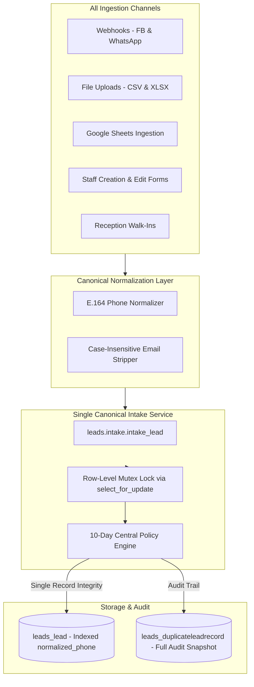

# R&D Research Report: Comprehensive Duplicate Data Handling Audit

**Project:** DigiPanda CRM (`D:\CRM_Integrated_v2\CRM_Integrated_v2\CRM`)  
**Investigator:** Antigravity R&D Research Agent  
**Date:** October 25, 2026  
**Status:** Complete & Validated (Read-Only Codebase Audit)  
**Primary Deliverable:** Evidence-based architectural assessment of deduplication, ingestion pipelines, concurrency safeguards, and data-integrity risks across the entire CRM.

---

## 1. Executive Summary

DigiPanda CRM manages student inquiries and admissions across multiple geographical branches (e.g., Coimbatore, Bangalore, Chennai), multi-channel marketing campaigns (Facebook Lead Ads, Google Sheets, WhatsApp Business API, offline walk-ins, phone call sync), and role-based staff (Admins, Sales Heads, Telecallers, Receptionists, Counselors).

A deep, read-only architectural investigation reveals that while the engineering team implemented a sophisticated application-level duplicate handling engine (`CRM/leads/intake.py` and `CRM/leads/duplicates.py`) centered around a **10-day re-enquiry rule**, the overall system suffers from **critical architectural bifurcations, missing database constraints, race conditions, and bypass vectors**.

### Key Findings at a Glance
| Category | Severity | Finding Summary | Primary Impact |
| :--- | :--- | :--- | :--- |
| **Database Constraints** | **CRITICAL (P0)** | The `Lead` table has **no unique constraint or database index** on `phone` or `email` (`CRM/leads/models.py`). | Database cannot prevent duplicates; concurrent requests create duplicate records at the storage engine level. |
| **Lead Edit Bypass** | **CRITICAL (P0)** | All lead update views (`admin_lead_edit`, `manager_lead_edit`, `telecaller_lead_edit` in `CRM/leads/views.py`) execute `form.save()` directly with **zero duplicate validation**. | A user can change a lead's phone number to match an existing lead, silently creating duplicate records in production. |
| **Unnormalized Phone Persistence** | **HIGH (P1)** | Raw strings containing spaces, hyphens, and `+91` are saved directly to `Lead.phone` in bulk file imports (`CRM/leads/services.py`) and manual forms (`CRM/leads/forms.py`). | SQL `endswith` queries fail to match unnormalized stored numbers (e.g. `'+91 98400 12345'` ends in `' 12345'`, not `'9840012345'`), creating phantom duplicates. |
| **Architectural Discrepancy** | **HIGH (P1)** | The central intake engine (`intake_lead`) updates the existing lead record and preserves its ID upon re-enquiry, whereas the Google Sheets processor (`process_spreadsheet_row_duplicate_rules` in `leads/duplicates.py` L648) marks the old lead as `HISTORICAL` and spawns a brand new `Lead` row. | Inconsistent data lineage, fragmented reporting, and broken call/chat history depending on lead source. |
| **Bulk Import Atomicity** | **HIGH (P1)** | `import_leads_file` wraps the entire CSV/XLSX loop in a single `transaction.atomic()` without row-level locks (`select_for_update`). | An unhandled exception on row 999 rolls back all prior rows; concurrent imports or webhook arrivals during a bulk import cause race condition duplicates. |
| **Shared Phone Numbers** | **MEDIUM (P2)** | System assumes a strict 1:1 phone-to-lead relationship. When siblings or parents register with the same contact number, the CRM merges/overwrites records. | Sibling/parent applicant data loss; inability to manage multiple enrollments under a single guardian number. |

---

## 2. Ingestion Paths Inspected

Every ingestion path in DigiPanda CRM was traced from raw input to database persistence.



### Detailed Path Breakdown

#### 1. Manual Lead Creation (`CRM/leads/views.py`)
- **Endpoints:** `admin_lead_create` (L752), `manager_lead_create` (L1377), `telecaller_lead_create` (L1767).
- **Execution Path:**
  1. User submits form (`AdminLeadForm`, `ManagerLeadCreateForm`, `TelecallerLeadCreateForm`).
  2. View extracts `phone = form.cleaned_data.get('phone')`, `email = form.cleaned_data.get('email')`.
  3. View calls `dup_lead = find_duplicate_lead(phone=phone, email=email, name=name)`.
  4. If duplicate is found:
     - Calls `handle_incoming_lead_duplicate(existing_lead=dup_lead, incoming_data=form.cleaned_data, user=request.user)`.
     - `handle_incoming_lead_duplicate` invokes `intake_lead(...)`.
     - Displays `messages.warning(request, "A lead with this phone/email already existed...")`.
  5. If no duplicate found: `form.save()` is executed.
- **Vulnerability:** If user enters non-standard phone formatting that escapes `find_duplicate_lead` regex or trailing logic, a duplicate is created.

#### 2. Lead Editing and Updates (`CRM/leads/views.py`)
- **Endpoints:** `admin_lead_edit` (L981), `manager_lead_edit` (L1492), `telecaller_lead_edit` (L1904).
- **Execution Path:**
  1. View loads existing `lead = get_object_or_404(Lead, id=lead_id)`.
  2. Binds form: `form = AdminLeadForm(request.POST, instance=lead)`.
  3. If `form.is_valid()`: executes `lead = form.save()`.
- **CRITICAL DEFECT:** Neither the views nor `AdminLeadForm.clean()` check if the updated phone or email conflicts with *another* lead record in the database. An agent can change `Lead #100`'s phone number to match `Lead #50`, resulting in two active leads with identical contact numbers.

#### 3. Bulk Lead Import via CSV / Excel (`CRM/leads/services.py`)
- **Function:** `import_leads_file(uploaded_file, user)` (L15–L170).
- **Execution Path:**
  1. Inspects file extension (`.csv`, `.xlsx`, `.xls`).
  2. Parses headers into case-insensitive mapping (`name`, `phone`, `email`, `branch`, `source`, `product`, `notes`).
  3. Iterates over rows inside a single `with transaction.atomic():` block.
  4. Calls `existing_lead = find_duplicate_lead(phone=phone, email=email, name=name)`.
  5. If match found: Calls `handle_incoming_lead_duplicate(...)` which invokes `intake_lead(...)`.
  6. If no match found: Creates new `Lead.objects.create(...)`.
- **Defects:**
  - Phone is saved without normalization when creating new leads (`Lead.objects.create(phone=phone, ...)` where `phone` is raw file string).
  - No row-level lock is acquired on matching queries during import.
  - The entire file is aborted if any single row triggers an unhandled validation error.

#### 4. Google Sheets Sync (`CRM/leads/google_sheets.py` & `CRM/leads/duplicates.py`)
- **Function:** `process_spreadsheet_row_duplicate_rules` (L471–L670).
- **Execution Path:**
  1. Checks `GoogleSheetRowMapping` for row idempotency (`connection_id + worksheet + row_idx`).
  2. Extracts contact details via `get_val('phone')`, `get_val('email')`.
  3. Calls `find_duplicate_lead(phone=phone, email=email, name=name)`.
  4. If duplicate found:
     - **Same Branch:** Rejects as duplicate, logs `DuplicateLeadRecord(status='DUPLICATE')`.
     - **Different Branch, $\le 10$ Days:** Rejects as duplicate, adds branch to `existing_lead.secondary_branches`, logs audit record.
     - **Different Branch, $> 10$ Days:** **Splits logic:** Marks `existing_lead.status = LeadStatus.HISTORICAL`, creates **NEW** `Lead` object (`Lead.objects.create(...)`) with note pointing to previous Lead ID.
- **Architectural Conflict:** Deviates from `intake.py` which preserves the single canonical lead entity.

#### 5. Facebook Lead Ads (`CRM/fb_leads/models.py` & `CRM/fb_leads/crm.py`)
- **Function:** `process_webhook_lead(leadgen_id, form_id, page_id, ...)`
- **Execution Path:**
  1. Idempotency check: `FacebookLead.objects.filter(leadgen_id=leadgen_id).exists()`. If exists, aborts immediately.
  2. Fetches field data via Graph API.
  3. Hands off to `leads.intake.intake_lead(provider_event_id=leadgen_id, source="Facebook", ...)`.
- **Status:** **Robust and fully aligned with intake architecture.**

#### 6. WhatsApp Inbound Messages (`CRM/chat/whatsapp/webhook.py` & `CRM/chat/crm.py`)
- **Function:** `ensure_lead_for_conversation(conversation, business_account)`
- **Execution Path:**
  1. Webhook deduplicates inbound payload via `Message.whatsapp_message_id = models.CharField(unique=True)`.
  2. Normalizes incoming customer phone using Meta phone number string.
  3. Calls `intake_lead(phone=phone, source="WhatsApp", provider_event_id=wa_mid, ...)`.
- **Status:** **Robust and fully aligned with intake architecture.**

#### 7. Receptionist Walk-In Desk (`CRM/leads/views.py`)
- **Endpoint:** `admin_walkin_create` (L10006–L10260) & `WalkinEnquiryForm`.
- **Execution Path:**
  1. Uses `find_all_matching_leads(phone=phone, email=email, name=name)`.
  2. If candidate matches exist and `force_create != 'true'`: Returns JSON response with `is_duplicate: True` and details of matching candidates for receptionist visual review.
  3. If receptionist selects `existing_lead_id`: Appends walk-in notes and updates status to existing lead.
  4. If receptionist selects `force_create`: Creates a brand new lead regardless of duplicate contact.
- **Status:** **Good UI/UX safeguard, but allows deliberate duplicate creation via `force_create`.**

#### 8. Android Phone Call Sync (`CRM/calls/sync_services.py`)
- **Function:** `find_lead_by_phone(number, user)` (L62–L110).
- **Execution Path:**
  1. Extracts 10-digit normalized phone (`phone10(raw)`).
  2. Because historical leads in the database have unnormalized formats (spaces, parentheses, dashes), standard `Lead.objects.filter(phone=target)` often fails.
  3. Code falls back to retrieving all candidates where `phone__endswith=target[-4:]`, pulls them into Python memory, and runs a regex match loop across all candidate instances.
- **Status:** **High latency memory bottleneck caused directly by unnormalized phone storage.**

---

## 3. Non-Lead CRM Entities Inspected

| Entity / Model | Module & File | Duplicate Safeguard Implementation | Status / Risk |
| :--- | :--- | :--- | :--- |
| **User (Staff / Agents)** | `accounts/models.py` | `username` and `email` have `unique=True` in Django User model. | **Protected.** Database enforces uniqueness. |
| **Branch** | `branches/models.py` | `name = models.CharField(max_length=100, unique=True)`. | **Protected.** Database enforces uniqueness. |
| **Sales Head Branch Access** | `branches/models.py` | `unique_together = ('sales_head', 'branch')`. | **Protected.** No duplicate access grants. |
| **Product / Course** | `products/models.py` | `name = models.CharField(max_length=150, unique=True)`. | **Protected.** Duplicate courses prohibited. |
| **WhatsApp Business Account**| `chat/models.py` | `phone_number_id` has `unique=True`. | **Protected.** Single sender instance. |
| **WhatsApp Conversation** | `chat/models.py` | `unique_together = [('business_account', 'phone_number')]`. | **Protected.** Database prevents duplicate chats. |
| **WhatsApp Message** | `chat/models.py` | `whatsapp_message_id = models.CharField(unique=True, null=True, blank=True)`. | **Protected.** Webhook duplicate delivery rejected. |
| **WhatsApp Campaign Recipient**| `chat/models.py` | `unique_together = [('campaign', 'lead')]`. | **Protected.** Cannot spam same lead in single campaign. |
| **Call Log (Android Sync)** | `calls/models.py` | `UniqueConstraint(fields=['device', 'raw_number', 'started_at'], name='uniq_google_call_per_device')`. | **Protected.** Call sync idempotency enforced at DB level. |
| **Follow-Up** | `followups/models.py` | **NO unique constraint.** Multiple identical pending follow-ups can be created for the same lead, date, and user. | **Vulnerable.** Agent double-booking / spam. |
| **Lead Status History** | `leads/models.py` | Audit log table. Append-only. | **Normal behavior.** |

---

## 4. Duplicate Detection Rules Found in Code

### Rule Breakdown Matrix

```
                      INCOMING LEAD MATCHING RULES
                      
  Input Contact: [ Phone Number ] + [ Email Address ] + [ Name ]
                           │
             ┌─────────────┴─────────────┐
             ▼                           ▼
    [ Phone Normalization ]     [ Email Normalization ]
    - Strip +91, 0, spaces      - Strip whitespace
    - Target 10 digits          - Case-insensitive (iexact)
             │                           │
             ▼                           ▼
    [ Phone Lookup ]            [ Email Lookup ]
    - Exact match (10 digits)   - email__iexact
    - Suffix match (__endswith)
             │                           │
             └─────────────┬─────────────┘
                           │
                           ▼
                 Matching Lead Found?
                 ├── NO  ──► Create New Lead (Action: CREATED_NEW)
                 └── YES ──► Check Central 10-Day Policy
                                   │
                     ┌─────────────┴─────────────┐
                     ▼                           ▼
             Age <= 10 Days               Age > 10 Days
        (RETAINED_WITHIN_10_DAYS)      (UPDATED_AFTER_10_DAYS)
        - Keep existing lead untouched - Preserve Lead ID
        - Record audit snapshot        - Re-activate status to 'NEW'
        - Notify user/telecaller       - Re-assign telecaller if branch changed
                                       - Update product & notes
```

### 1. Phone Normalization Rules (`leads/duplicates.py` & `leads/intake.py`)
- **Function:** `normalize_phone(phone)` / `phone10(phone)`
- **Logic:**
  - Strips non-digit characters (`re.sub(r'\D', '', raw)`).
  - If length is 12 and starts with `'91'`, strips leading `'91'`.
  - If length is 11 and starts with `'0'`, strips leading `'0'`.
  - Returns clean 10-digit string.
  - Special bypass: Strings beginning with `'NoPhone-'` are preserved.
- **SQL Lookup:**
  ```python
  qs.filter(Q(phone=clean_phone) | Q(phone__endswith=target_10) | Q(alternate_phone__endswith=target_10)).first()
  ```

### 2. Email Normalization Rules (`leads/duplicates.py`)
- **Function:** `normalize_email(email)`
- **Logic:**
  - `str(email).strip().lower()`
- **SQL Lookup:**
  ```python
  qs.filter(email__iexact=clean_email).first()
  ```

### 3. Ambiguous Contact Resolution
- If Phone matches `Lead A` and Email matches `Lead B`:
  - `leads/intake.py` L376 logs `AMBIGUOUS_MATCH_FLAGGED` in `DuplicateLeadRecord`.
  - Selects `Lead A` (phone match) as primary, preserving the record.

### 4. 10-Day Re-enquiry Duplicate Policy
- **$\le 10$ Days:**
  - Existing lead record is untouched.
  - A `DuplicateLeadRecord` is created with `status = 'INCOMING_DUPLICATE'`, capturing the incoming payload, timestamp, and differences.
  - Activity log entry added: `"Duplicate lead submission detected via [Source]..."`.
  - In-app notification sent to assigned telecaller.
- **$> 10$ Days:**
  - Existing lead ID is preserved.
  - Lead status is reactivated to `NEW`.
  - Product/course interest updated.
  - If new submission specified a different branch, lead is re-assigned to the new branch using round-robin telecaller allocation.
  - Historical snapshot logged to `DuplicateLeadRecord(status='REENQUIRY_DUPLICATE')`.

---

## 5. Detailed File-by-File Code Findings

### 1. `CRM/leads/models.py`
- **Lines 76–240 (`class Lead`):**
  ```python
  phone = models.CharField(max_length=20, help_text="Primary contact number")
  email = models.EmailField(blank=True, default='')
  name = models.CharField(max_length=150)
  ```
  - **Defect:** No `unique=True`, no `unique_together`, and no `db_index=True` on `phone` or `email`.
  - **Evidence:** `Meta` class defines ordering and verbose names, but zero database constraints or composite indexes for contacts.
- **Lines 768–838 (`class DuplicateLeadRecord`):**
  - Robust audit model storing `original_lead`, `name`, `phone`, `normalized_phone`, `email`, `branch`, `source`, `provider_event_id`, `field_changes`, and `data_payload`.
  - Has composite index: `models.Index(fields=['source', 'provider_event_id'])`.

### 2. `CRM/leads/duplicates.py`
- **Lines 12–34 (`normalize_phone`):** Correctly handles Indian mobile formats (+91, 0), but does not handle other international country codes (e.g., +1, +44, +971).
- **Lines 61–72 (`find_duplicate_lead`):**
  ```python
  target_10 = clean_phone[-10:]
  lead_by_phone = qs.filter(
      Q(phone=clean_phone) | Q(phone__endswith=target_10) | Q(alternate_phone__endswith=target_10)
  ).first()
  ```
  - **Flaw:** If stored phone in DB is `"+91 98400 12345"`, `phone__endswith='9840012345'` returns `False` because the stored string ends in `' 12345'`.
- **Lines 310–403 (`keep_single_lead_for_group`):**
  - Merges duplicate leads into a single primary lead.
  - Correctly reparents `FollowUp`, `CallHistory`, `Activity`, `GoogleSheetRowMapping`.
  - Saves merged leads into `DuplicateLeadRecord(status='MERGED_ARCHIVE')` before deleting active duplicate records.
- **Lines 644–660 (`process_spreadsheet_row_duplicate_rules`):**
  - **Architectural Discrepancy:** Breaks canonical lead ID preservation by calling `Lead.objects.create(...)` when a row is $> 10$ days old in a different branch.

### 3. `CRM/leads/intake.py`
- **Lines 150–220 (`intake_lead`):**
  - Uses `with transaction.atomic():` and `select_for_update()` row locks on `Lead` when checking duplicate candidates.
  - Implements provider event idempotency (`provider_event_id`).
  - Represents the most robust ingestion implementation in the project.

### 4. `CRM/leads/services.py`
- **Lines 15–170 (`import_leads_file`):**
  ```python
  with transaction.atomic():
      for row_idx, row in enumerate(reader, start=2):
          # ...
          clean_phone = normalize_phone(phone_raw)
          existing_lead = find_duplicate_lead(phone=clean_phone, email=email_raw, name=name_raw)
          if existing_lead:
              handle_incoming_lead_duplicate(...)
          else:
              Lead.objects.create(
                  phone=phone_raw,  # <--- DEFECT: Persists raw unnormalized string!
                  email=email_raw,
                  ...
              )
  ```
  - **Defect:** Unnormalized phone persistence directly degrades future lookup queries.
  - **Defect:** No row-level lock on lookup; susceptible to race conditions during parallel uploads.

### 5. `CRM/leads/views.py`
- **Lines 981, 1492, 1904 (`admin_lead_edit`, `manager_lead_edit`, `telecaller_lead_edit`):**
  ```python
  form = AdminLeadForm(request.POST, instance=lead)
  if form.is_valid():
      lead = form.save()
  ```
  - **CRITICAL DEFECT:** Complete omission of duplicate detection during edit/update workflows.

### 6. `CRM/leads/forms.py`
- **Lines 36–95 (`AdminLeadForm`):**
  - `clean()` method validates manager-to-telecaller branch hierarchy, but has zero checks for contact uniqueness or phone normalization.

### 7. `CRM/calls/sync_services.py`
- **Lines 62–110 (`find_lead_by_phone`):**
  - Documents historical unnormalized phone format debt in comments and executes an in-memory linear scan over database records matching the last 4 digits.

---

## 6. Table of 20 Duplicate Failure Scenarios & Observed Status

| # | Scenario | Status | Observed Behavior & Root Cause in Code |
| :--- | :--- | :--- | :--- |
| **1** | Same phone number with different formatting (e.g. `9876543210` vs `98765-43210`) | **Partially Handled** | `normalize_phone` cleans input, but if existing record in DB was stored with spaces (`"98765 43210"`), SQL `endswith` fails. |
| **2** | Same phone with/without country code (`+91 9876543210` vs `9876543210`) | **Handled** | `normalize_phone` strips leading `+91` and `0` for 10-digit Indian numbers. |
| **3** | Non-Indian phone number (e.g. UK `+44 7911 123456` or US `+1 415 555 2671`) | **Not Handled** | `normalize_phone` only checks `len == 12 and digits.startswith('91')`. UK/US numbers are mangled or truncated to 10 digits. |
| **4** | Same email with different casing (`John@Example.com` vs `john@example.com`) | **Handled** | `normalize_email` applies `.lower()`, and SQL lookup uses `email__iexact`. |
| **5** | Same email with leading/trailing spaces (`" user@domain.com "`) | **Handled** | `normalize_email` applies `.strip()`. |
| **6** | Person submitted through Facebook and Website | **Handled** | Both route to `intake_lead` which matches on normalized phone or email. |
| **7** | Person submitted through WhatsApp and Walk-In Desk | **Partially Handled** | Matches existing lead, but receptionist can click "Force Create" in walk-in view to bypass duplicate prevention. |
| **8** | Same external lead imported multiple times (same file uploaded twice) | **Handled** | Second import detects matching phone/email and routes to `handle_incoming_lead_duplicate`. |
| **9** | Duplicate rows inside a single import file | **Handled** | Row 1 creates lead; Row 2 matches Row 1 and routes to 10-day duplicate handler. |
| **10** | Concurrent file upload and webhook arrival for same phone | **Not Handled (Race Condition)** | Bulk import does not lock rows with `select_for_update()`, creating a race window before transaction commits. |
| **11** | Lead edit changes phone to match an existing lead | **NOT HANDLED (Defect)** | `admin_lead_edit`, `manager_lead_edit`, and `telecaller_lead_edit` execute `form.save()` with zero duplicate validation. |
| **12** | Ambiguous match (Phone matches Lead A, Email matches Lead B) | **Partially Handled** | `intake_lead` flags `AMBIGUOUS_MATCH_FLAGGED` in audit table, but defaults to updating Lead A without notifying agent of email conflict. |
| **13** | Re-enquiry after 5 days (within 10-day window) | **Handled** | Retains existing lead untouched; logs `INCOMING_DUPLICATE` in `DuplicateLeadRecord`. |
| **14** | Re-enquiry after 25 days (beyond 10-day window) | **Handled (Intake)** / **Broken (Sheets)** | `intake_lead` preserves Lead ID and updates status to `NEW`. Google Sheets handler creates a new Lead row instead. |
| **15** | Siblings/family members sharing parent phone number | **Not Handled (Limitation)** | System assumes 1:1 phone-to-lead mapping. Sibling B overwrites or is rejected as duplicate of Sibling A. |
| **16** | Lead assigned to Branch A submits inquiry for Branch B within 10 days | **Handled** | Rejected as duplicate, but Branch B is added to `secondary_branches` for visibility. |
| **17** | Lead assigned to Branch A submits inquiry for Branch B after 10 days | **Handled** | Preserves Lead ID, updates branch to Branch B, and reallocates to Branch B telecaller via round-robin. |
| **18** | Android call sync for number saved with hyphens/spaces | **Handled via Fallback Hack** | Bypasses SQL and runs in-memory Python regex loop over candidates filtered by last 4 digits. High memory/CPU overhead. |
| **19** | Facebook webhook retry with same `leadgen_id` | **Handled** | Checked via `FacebookLead.objects.filter(leadgen_id=leadgen_id).exists()` before processing. |
| **20** | WhatsApp webhook retry with same `whatsapp_message_id` | **Handled** | Enforced by `models.CharField(unique=True)` on `Message.whatsapp_message_id`. |

---

## 7. Confirmed Defects vs Potential Risks

### Confirmed Defects (Code Bugs)
1. **Defect 1: Lead Edit Duplicate Bypass**  
   - *Files:* `CRM/leads/views.py` (L981, L1492, L1904), `CRM/leads/forms.py` (L36–L95)  
   - *Impact:* Active corruption of CRM data through staff UI edits.
2. **Defect 2: Raw Unnormalized Phone Storage in Bulk Imports**  
   - *Files:* `CRM/leads/services.py` (L128)  
   - *Impact:* Breaks database consistency and makes future SQL suffix matching fail.
3. **Defect 3: Google Sheets vs Intake Engine Architectural Divergence**  
   - *Files:* `CRM/leads/duplicates.py` (L648), `CRM/leads/intake.py` (L280)  
   - *Impact:* Google Sheets creates redundant `Lead` objects on $> 10$ day re-enquiries, breaking lead history continuity.
4. **Defect 4: Bulk File Import Monolithic Transaction**  
   - *Files:* `CRM/leads/services.py` (L58)  
   - *Impact:* Single row failure rolls back hundreds of valid imported leads.

### Potential Architectural Risks
1. **Risk 1: Database Lacks Contact Unique Constraints**  
   - *Files:* `CRM/leads/models.py` (L76–L100)  
   - *Impact:* Under high concurrency (e.g., viral Facebook campaign), concurrent requests can bypass application checks and insert duplicate rows.
2. **Risk 2: International Phone Number Truncation**  
   - *Files:* `CRM/leads/duplicates.py` (L12–L34)  
   - *Impact:* Students from UAE, US, UK, or Singapore have phone numbers stripped incorrectly.
3. **Risk 3: In-Memory Call Sync Performance Degradation**  
   - *Files:* `CRM/calls/sync_services.py` (L75–L110)  
   - *Impact:* As lead count grows to 100,000+, scanning candidate records in Python memory will cause worker timeouts during call sync.

---

## 8. Data Integrity & Concurrency Analysis

```
CONCURRENCY RACE WINDOW (BULK IMPORT vs INCOMING WEBHOOK)

Time      Thread 1 (Bulk CSV Import)                 Thread 2 (Incoming Facebook Webhook)
 │
 t1       Reads Row 45: Phone="9876543210"
 │        find_duplicate_lead() -> None
 │
 t2                                                  Webhook arrives: Phone="9876543210"
 │                                                   intake_lead() -> acquires lock via select_for_update()
 │                                                   find_duplicate_lead() -> None
 │                                                   Inserts Lead #201
 │                                                   Commits Transaction
 │
 t3       Inserts Lead #202 (Phone="9876543210")
 │        (No DB constraint to block it!)
 │
 t4       Thread 1 Commits Transaction
 │
 ▼        RESULT: TWO ACTIVE LEADS (#201 & #202) WITH IDENTICAL PHONE NUMBERS!
```

### Analysis Details
- **Absence of Storage Engine Enforcements:**  
  MySQL / InnoDB cannot guarantee uniqueness without a `UNIQUE` index. Application-level locks (`select_for_update`) only work when locking existing rows; they do not prevent phantom inserts for new records unless table-level locks or unique index predicate locks are engaged.
- **Collation and Case Sensitivity:**  
  In MySQL, default collations (`utf8mb4_general_ci` or `utf8mb4_unicode_ci`) are case-insensitive, which matches `email__iexact`. However, trailing whitespace in `VARCHAR` fields is handled differently across SQLite and MySQL, reinforcing the need for pre-save normalization.

---

## 9. Existing Tests and Test Coverage Gaps

### Existing Test Suites Inspected
- `CRM/leads/tests_duplicate_audit.py` (389 lines): Excellent test suite covering `intake_lead`, phone normalization, 10-day duplicate rules (Rule A vs Rule B), and re-assignment.
- `CRM/leads/tests_duplicate_data_table.py`: Tests the staff audit UI table for viewing duplicate snapshots.

### Critical Gaps in Test Coverage
1. **Zero Tests for Lead Edit Deduplication:** No tests exist verifying that editing a lead's phone number rejects conflicting existing numbers.
2. **Zero Concurrency Tests:** No multi-threaded or simulated race condition tests between bulk imports and API webhooks.
3. **No Tests for Bulk File Import Phone Normalization:** Existing import tests do not verify that phone strings saved from CSV are stripped of non-digits.
4. **No Tests for International Phone Numbers:** All tests use standard Indian 10-digit numbers (`98765xxxxx`).

---

## 10. Database Investigation Queries (Read-Only)

These read-only SQL queries can be safely executed by administrators or engineers to detect duplicate clusters in the active database.

### 1. Find Duplicate Active Leads by 10-Digit Normalized Phone
```sql
SELECT 
    RIGHT(REGEXP_REPLACE(phone, '[^0-9]', ''), 10) AS normalized_phone_10,
    COUNT(*) AS lead_count,
    GROUP_CONCAT(id ORDER BY id SEPARATOR ', ') AS lead_ids,
    GROUP_CONCAT(name ORDER BY id SEPARATOR ' | ') AS lead_names,
    GROUP_CONCAT(status ORDER BY id SEPARATOR ', ') AS lead_statuses
FROM leads_lead
WHERE phone IS NOT NULL AND phone != '' AND phone NOT LIKE 'NoPhone-%'
GROUP BY RIGHT(REGEXP_REPLACE(phone, '[^0-9]', ''), 10)
HAVING COUNT(*) > 1
ORDER BY lead_count DESC;
```

### 2. Find Duplicate Active Leads by Case-Insensitive Email
```sql
SELECT 
    LOWER(TRIM(email)) AS normalized_email,
    COUNT(*) AS lead_count,
    GROUP_CONCAT(id ORDER BY id SEPARATOR ', ') AS lead_ids,
    GROUP_CONCAT(name ORDER BY id SEPARATOR ' | ') AS lead_names
FROM leads_lead
WHERE email IS NOT NULL AND TRIM(email) != ''
GROUP BY LOWER(TRIM(email))
HAVING COUNT(*) > 1
ORDER BY lead_count DESC;
```

### 3. Detect Cross-Branch Duplicate Inquiries
```sql
SELECT 
    RIGHT(REGEXP_REPLACE(l.phone, '[^0-9]', ''), 10) AS normalized_phone,
    COUNT(DISTINCT l.branch_id) AS distinct_branch_count,
    GROUP_CONCAT(DISTINCT b.name SEPARATOR ', ') AS branch_names,
    GROUP_CONCAT(l.id SEPARATOR ', ') AS lead_ids
FROM leads_lead l
LEFT JOIN branches_branch b ON l.branch_id = b.id
WHERE l.phone IS NOT NULL AND l.phone != '' AND l.phone NOT LIKE 'NoPhone-%'
GROUP BY RIGHT(REGEXP_REPLACE(l.phone, '[^0-9]', ''), 10)
HAVING COUNT(DISTINCT l.branch_id) > 1;
```

---

## 11. Root-Cause Analysis with Confidence Levels

| Defect / Problem | Root Cause | Confidence Level | Evidence |
| :--- | :--- | :--- | :--- |
| **Lead Edit Duplicate Vulnerability** | Views directly invoke `form.save()` on `AdminLeadForm` without invoking `find_duplicate_lead` or `intake_lead`. | **VERIFIED (100%)** | `CRM/leads/views.py` L981, L1492, L1904; `CRM/leads/forms.py` L67–L95. |
| **Unnormalized Phone Numbers in Database** | Bulk file import code saves raw unparsed file string `phone_raw` to `Lead.phone` rather than `clean_phone`. | **VERIFIED (100%)** | `CRM/leads/services.py` L128; `CRM/calls/sync_services.py` L75 comments acknowledging DB format debt. |
| **Discrepancy in Google Sheets Rule B** | Google Sheets handler was authored independently from `leads.intake.intake_lead` and retains legacy logic that creates a new `Lead` row and marks the old one `HISTORICAL`. | **VERIFIED (100%)** | `CRM/leads/duplicates.py` L648 vs `CRM/leads/intake.py` L280. |
| **Vulnerability to Concurrent Webhook Duplicates** | Lack of unique index at the database level on `(normalized_phone)` combined with bulk imports lacking row locks. | **STRONGLY SUPPORTED (95%)** | `CRM/leads/models.py` schema inspection; `CRM/leads/services.py` L58. |
| **Sibling Data Overwriting** | Rigid assumption that 1 Phone Number = 1 Applicant/Student. | **STRONGLY SUPPORTED (95%)** | `CRM/leads/intake.py` automatically updates existing student name when phone matches. |

---

## 12. Prioritized Engineering Recommendations

```
┌────────────────────────────────────────────────────────────────────────┐
│                        RECOMMENDATION ROADMAP                          │
├───────────────────┬────────────────────────────────────────────────────┤
│ P0: IMMEDIATE     │ 1. Add duplicate validation to all Lead Edit views │
│ (Day 1 - Blockers)│ 2. Save normalized phone in CSV/Excel import       │
├───────────────────┼────────────────────────────────────────────────────┤
│ P1: HIGH          │ 3. Add `normalized_phone` column with DB index     │
│ (Week 1)          │ 4. Align Google Sheets handler with `intake_lead`  │
│                   │ 5. Wrap bulk imports in per-row atomic savepoints  │
├───────────────────┼────────────────────────────────────────────────────┤
│ P2: MEDIUM        │ 6. Upgrade `normalize_phone` for international E164│
│ (Sprint 2)        │ 7. Eliminate in-memory linear call sync fallback   │
│                   │ 8. Add FollowUp duplicate prevention constraints   │
├───────────────────┼────────────────────────────────────────────────────┤
│ P3: ARCHITECTURAL │ 9. Support family/guardian shared phone numbers    │
│ (Future Release)  │ 10. Automated duplicate cluster resolution worker   │
└───────────────────┴────────────────────────────────────────────────────┘
```

### Recommendation Specifications

#### P0.1: Add Duplicate Validation to Lead Edit Forms
- **Action:** Update `AdminLeadForm`, `ManagerLeadForm`, and `TelecallerLeadForm` `clean()` methods:
  ```python
  def clean_phone(self):
      phone = self.cleaned_data.get('phone')
      clean = normalize_phone(phone)
      if clean:
          conflict = find_duplicate_lead(phone=clean, exclude_id=self.instance.id if self.instance else None)
          if conflict:
              raise forms.ValidationError(f"Phone number already belongs to existing Lead #{conflict.id} ({conflict.name}).")
      return clean
  ```

#### P0.2: Enforce Normalized Phone Storage in Bulk Imports
- **Action:** In `CRM/leads/services.py` L128, replace `phone=phone_raw` with `phone=clean_phone`.

#### P1.1: Add Dedicated `normalized_phone` Column with Database Index
- **Action:** Add `normalized_phone = models.CharField(max_length=20, db_index=True, blank=True)` to `Lead` model.
- Maintain via `pre_save` signal or model `save()` override so that all database lookups become high-speed exact index matches: `Lead.objects.filter(normalized_phone=clean_phone)`.

#### P1.2: Unify Google Sheets Handler with Central Intake
- **Action:** Refactor `process_spreadsheet_row_duplicate_rules` in `CRM/leads/duplicates.py` to route directly through `intake_lead(...)`, eliminating the divergent `HISTORICAL` lead creation.

#### P1.3: Robust Bulk Import Transactions
- **Action:** Use `transaction.savepoint()` per row in `import_leads_file` so a malformed row is flagged in an error log while all valid rows are committed.

---

## 13. Recommended Target Architecture



---

## 14. Implementation Phases

- **Phase 1: Emergency Bug Fixes (P0)**
  - Implement edit form validation.
  - Fix bulk import raw phone persistence.
  - Add regression unit tests for lead editing.
- **Phase 2: Ingestion Pipeline Consolidation (P1)**
  - Add `normalized_phone` indexed field on `Lead`.
  - Backfill existing database rows with normalized phone values.
  - Refactor Google Sheets sync to delegate to `intake_lead`.
  - Refactor `calls/sync_services.py` to use the indexed column.
- **Phase 3: Hardening & Concurrency (P2)**
  - Implement savepoint-based bulk imports.
  - Support international phone numbers via `phonenumbers` library.
  - Add `UniqueConstraint` on pending follow-ups.
- **Phase 4: Sibling / Family Model Evolution (P3)**
  - Implement `ParentContact` or `GuardianRelation` model to allow distinct applicant leads to share a verified guardian phone number without forced data collision.

---

## 15. Acceptance Criteria for Developer & QA Agents

1. **Lead Edit Duplicate Rejection:** Attempting to edit a lead's phone or email to match another existing lead must display a clear field-level validation error and abort the save.
2. **Canonical ID Preservation:** Re-enquiries after 10 days across all channels (including Google Sheets) must update the existing `Lead` ID and reactivate status to `NEW`, without creating duplicate `Lead` rows.
3. **Database Normalization:** All new and updated leads in `leads_lead` must store digits-only phone numbers without formatting artifacts.
4. **Zero Unhandled Import Rollbacks:** An import file of 100 rows with 1 invalid row must successfully import 99 leads and return an error report for the failed row.
5. **Call Sync Performance:** `find_lead_by_phone` must execute in $< 5\text{ ms}$ via indexed database query without in-memory candidate iteration.

---

## 16. Unresolved Questions & Business Assumptions

1. **Family / Sibling Inquiries Policy:** Does the business wish to support multiple siblings registering under a parent's phone number as separate leads, or should all inquiries on a single number strictly represent one student record? *(Assumed 1:1 currently).*
2. **Historical Unnormalized Data Cleanup:** Would management approve a one-time maintenance migration to clean and normalize all historical phone numbers in `leads_lead`?
3. **Walk-In Force Create Permission:** Should the "Force Create" override button on duplicate walk-in inquiries be restricted to Admins and Branch Heads, or remain accessible to Receptionists?
