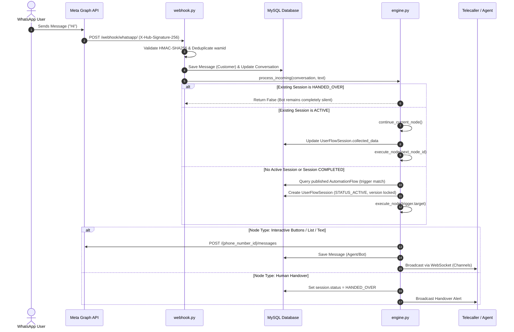
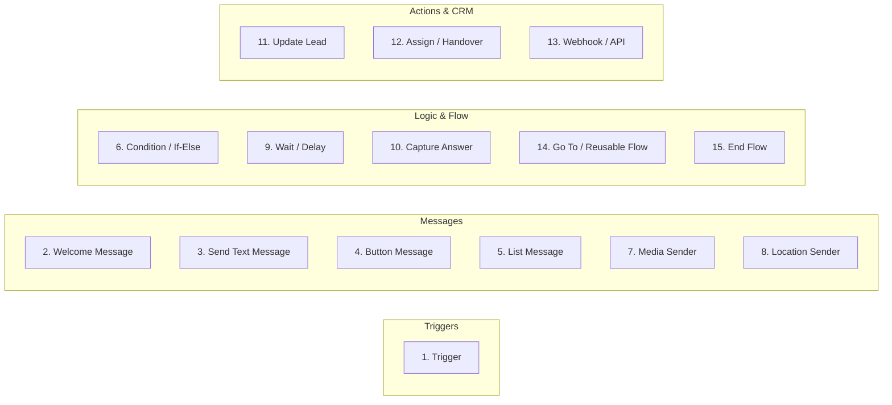
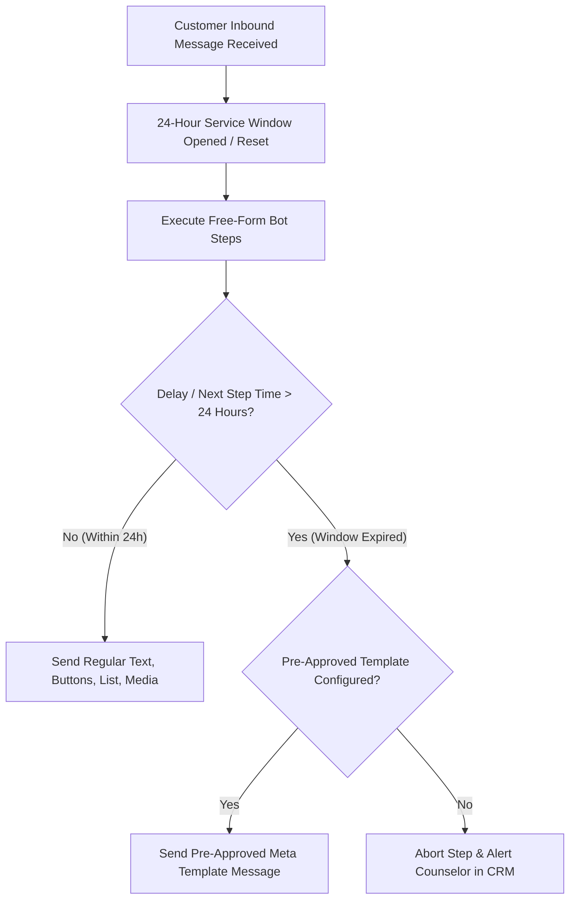
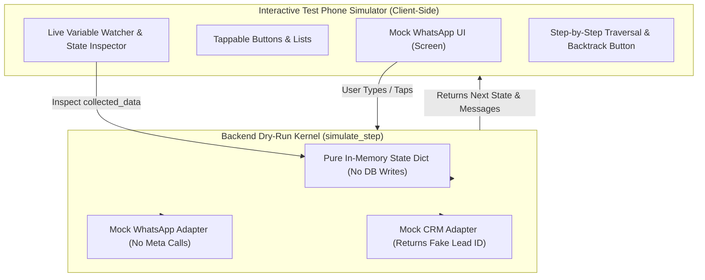
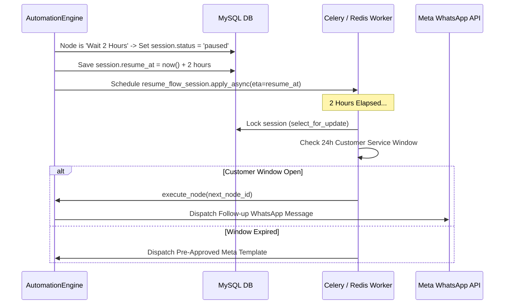
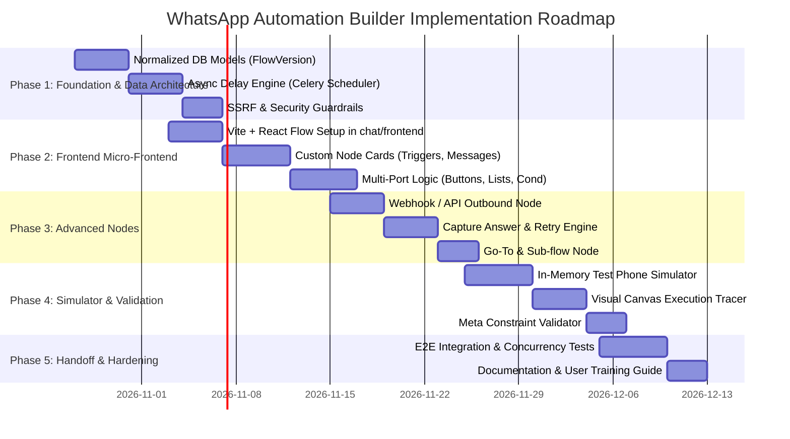

# Comprehensive R&D Research Report: WhatsApp Visual Workflow Builder & Execution Engine

**Document Identifier:** `RND-WA-AUTO-2026-10-24`  
**Author:** Lead R&D Research Engineer (Antigravity R&D Agent)  
**Status:** Complete / Execution Ready  
**Target Codebase:** DigiPanda CRM (`CRM_Integrated_v2`)  
**Target Architecture:** n8n-Inspired No-Code Visual Flow Builder & WhatsApp Business Cloud API Engine  

---

## 1. Executive Summary

DigiPanda CRM currently operates a custom, hand-coded visual automation builder and an in-process graph execution engine for WhatsApp conversational workflows. While functional for basic linear and simple branching interactions, the system suffers from significant architectural limitations, scalability constraints, and visual ergonomics challenges. Specifically, the canvas is implemented in a single 4,011-line vanilla JavaScript file with manual SVG trigonometric curve math, lacking modularity; the `delay` node fails to pause execution (falling through synchronously); crucial node types such as outbound Webhook/API calls and Go-To/Sub-flows are absent; condition evaluation is limited to binary YES/NO logic; and rapid concurrent incoming customer messages can trigger race conditions on unversioned session states.

To transform this system into a professional, **n8n-inspired no-code visual workflow platform**, this research evaluates:
1. The end-to-end architecture of the existing automation subsystem.
2. Five candidate visual workflow editor technologies, recommending **React Flow (`@xyflow/react`) packaged as a zero-overhead Vite micro-frontend** embedded directly into the Django template.
3. The official **Meta WhatsApp Cloud API specifications and constraints** across all **15 required node types**.
4. A safe, deterministic **dry-run simulator** operating purely in-memory.
5. An enterprise **draft-persistence, immutable versioning, and execution tracing** schema.
6. A comprehensive **security and reliability framework** protecting against SSRF, webhook tampering, race conditions, and messaging window violations.

---

## 2. Verified Existing-System Architecture & Codebase Evidence

A comprehensive audit of the `CRM/chat` subsystem establishes the following architecture:

### 2.1 Codebase File Map & Core Components

| Component / File Path | Core Classes / Functions | Primary Responsibility |
| :--- | :--- | :--- |
| [`chat/models.py`](file:///D:/CRM_Integrated_v2/CRM_Integrated_v2/CRM/chat/models.py#L6-L400) | `BusinessAccount`, `Conversation`, `Message`, `AutomationFlow`, `UserFlowSession`, `AutomationExecution` | Database persistence for channels, conversations, workflow definitions, customer state machines, and execution telemetry. |
| [`chat/automation/engine.py`](file:///D:/CRM_Integrated_v2/CRM_Integrated_v2/CRM/chat/automation/engine.py#L49-L880) | `AutomationEngine`, `process_incoming`, `continue_current_node`, `execute_node`, `simulate_step` | Core graph traversal, session state routing, variable interpolation, conditional evaluation, and WhatsApp dispatch. |
| [`chat/automation/validator.py`](file:///D:/CRM_Integrated_v2/CRM_Integrated_v2/CRM/chat/automation/validator.py#L10-L285) | `validate_flow_graph`, cycle detection, orphan detection | Enforces graph structural integrity, Meta API constraints (e.g., 3-button limit, 24-character list titles), and reachability prior to publishing. |
| [`chat/automation/templates.py`](file:///D:/CRM_Integrated_v2/CRM_Integrated_v2/CRM/chat/automation/templates.py#L1-L100) | `get_default_admissions_flow_data` | Default seed workflow JSON definition for DigiPanda admissions and career counseling. |
| [`chat/whatsapp/messages.py`](file:///D:/CRM_Integrated_v2/CRM_Integrated_v2/CRM/chat/whatsapp/messages.py#L15-L295) | `send_text_message`, `send_interactive_buttons`, `send_interactive_list`, `send_media_message`, `send_location_message` | Formats and dispatches Meta-compliant JSON payloads for text, reply buttons, list menus, documents/media, and GPS pins. |
| [`chat/whatsapp/webhook.py`](file:///D:/CRM_Integrated_v2/CRM_Integrated_v2/CRM/chat/whatsapp/webhook.py#L19-L270) | `verify_webhook_token`, `process_incoming_message`, `process_message_status` | Handles Meta hub verification handshake, validates inbound message/status webhooks, manages deduplication, and invokes `AutomationEngine`. |
| [`chat/whatsapp/client.py`](file:///D:/CRM_Integrated_v2/CRM_Integrated_v2/CRM/chat/whatsapp/client.py#L17-L100) | `WhatsAppClient`, `send_payload`, `upload_media` | Low-level HTTP requests to Meta Graph API (`graph.facebook.com/v21.0`), handling Bearer tokens and connection timeouts. |
| [`chat/views.py`](file:///D:/CRM_Integrated_v2/CRM_Integrated_v2/CRM/chat/views.py#L511-L805) | `FlowBuilderView`, `AutomationFlowListAPI`, `AutomationFlowDetailAPI`, `AutomationFlowPublishAPI`, `AutomationFlowSimulateAPI` | REST API endpoints for loading, auto-forking, validating, simulating, and publishing workflow graphs. |
| [`chat/static/chat/js/flow_builder.js`](file:///D:/CRM_Integrated_v2/CRM_Integrated_v2/CRM/chat/static/chat/js/flow_builder.js#L1-L200) | `init`, `renderCanvas`, `drawConnectionLines`, `executeSimNode` | 4,011-line vanilla JavaScript application handling drag-and-drop canvas, bezier curve rendering, node inspector, and chat simulator. |
| [`chat/templates/chat/flow_builder.html`](file:///D:/CRM_Integrated_v2/CRM_Integrated_v2/CRM/chat/templates/chat/flow_builder.html#L38-L350) | Top navigation bar, node palette sidebar, canvas viewport, properties inspector drawer, and simulator drawer. | DOM scaffolding and SVG definition for the existing editor. |

### 2.2 End-to-End Inbound Message Execution Flow



---

## 3. Current Defects, Technical Debt & Architectural Gaps

An engineering audit identified critical defects, code smells, and architectural gaps in the current implementation:

### 3.1 Defect & Architectural Limitation Inventory

| Issue ID | Category | Component | Root Cause & Code Evidence | Impact |
| :--- | :--- | :--- | :--- | :--- |
| **GAP-001** | Architecture | [`engine.py#L613-L618`](file:///D:/CRM_Integrated_v2/CRM_Integrated_v2/CRM/chat/automation/engine.py#L613-L618) | **Delay Node is a Stub:** The engine executes `delay` by immediately following `get_target_node_id` with `execution_depth + 1`. No delayed task, timer, Celery job, or timestamp comparison is performed. | Users configure a "Wait 2 Hours" node, but the bot responds immediately without any pause. |
| **GAP-002** | Frontend | [`flow_builder.js`](file:///D:/CRM_Integrated_v2/CRM_Integrated_v2/CRM/chat/static/chat/js/flow_builder.js#L1-L4011) | **Monolithic 4,011-Line Script:** All canvas manipulation, SVG path calculations (`getBezierPath`), coordinate transforms, DOM event listeners, node card templates, and inspector bindings reside in a single giant file. | Extremely fragile; adding new ports or complex nodes requires editing 8+ distinct functions across thousands of lines. High regression risk. |
| **GAP-003** | Capability | Backend & Frontend | **Missing Webhook / API Node:** No ability to trigger external HTTP endpoints (e.g., posting lead data to LMS, ERP, external scoring APIs, or Zapier). | Admins cannot connect chatbot responses to third-party web services. |
| **GAP-004** | Capability | Backend & Frontend | **Missing Go-To / Sub-flow Node:** The editor lacks any mechanism to reference reusable workflows or jump backward/forward across modular blocks without tangled spiderweb connections. | Graph becomes cluttered, repetitive, and unmaintainable for complex journeys. |
| **GAP-005** | Logic | [`engine.py#L666-L684`](file:///D:/CRM_Integrated_v2/CRM_Integrated_v2/CRM/chat/automation/engine.py#L666-L684) | **Binary-Only Condition Branching:** `Condition` node only supports two fixed output ports (`YES` and `NO`) based on single variable equality/containment. Multi-condition expressions (`AND`/`OR`) and multi-branch Switch-Case are unsupported. | Requires chaining 5+ condition nodes to implement simple multi-option branching logic. |
| **GAP-006** | Concurrency | [`engine.py#L116-L180`](file:///D:/CRM_Integrated_v2/CRM_Integrated_v2/CRM/chat/automation/engine.py#L116-L180) | **Unprotected Session Race Condition:** `process_incoming` queries `UserFlowSession` without database row-level locking (`select_for_update()`). If a customer rapidly double-taps buttons or sends two quick messages, both webhook threads load the same node and execute duplicate responses. | Duplicate bot messages dispatched to customer; collected data overwritten. |
| **GAP-007** | Data Model | [`chat/views.py#L564-L582`](file:///D:/CRM_Integrated_v2/CRM_Integrated_v2/CRM/chat/views.py#L564-L582) | **Row-Duplicating Versioning:** Creating a draft duplicates the entire `AutomationFlow` database record with `version = latest + 1`. This leads to table bloat and confuses list views where multiple rows represent revisions of the same conceptual flow. | Unclear lineage and difficult audit trails across draft vs. published versions. |
| **GAP-008** | Usability | [`flow_builder.js#L880-L1100`](file:///D:/CRM_Integrated_v2/CRM_Integrated_v2/CRM/chat/static/chat/js/flow_builder.js#L880-L1100) | **Simulator Cannot Step or Mock External Context:** The simulator only runs linear execution in-memory. It cannot step backwards, cannot mock custom variable values, cannot simulate webhook events, and cannot save test scenarios. | Testing complex workflows requires manually clicking through from step 1 every time. |

---

## 4. Visual Workflow Editor Technology Comparison

To achieve an **n8n-grade user experience** (clean modern node cards, smooth bezier curves, mini-map, collapsible parameter panels, touch support, sub-flows, and high frame rates), we evaluated five primary frontend graph technologies:

### 4.1 Comparative Evaluation Matrix

| Evaluation Criteria | 1. React Flow (`@xyflow/react`) | 2. Rete.js (v2) | 3. Drawflow | 4. LiteGraph.js | 5. Modern Vanilla Web Components |
| :--- | :--- | :--- | :--- | :--- | :--- |
| **GitHub Stars & Community** | ⭐ 27,000+ (Extremely active, backed by xyflow GmbH) | ⭐ 9,500+ (Active modular framework) | ⭐ 4,600+ (Low activity / semi-abandoned) | ⭐ 5,200+ (Active in ComfyUI ecosystem) | N/A (Internal proprietary) |
| **n8n Visual Resemblance & UI Polish** | **10 / 10** (n8n's visual builder is built on identical React graph paradigms) | **7 / 10** (Good, but styling requires deep custom renderers) | **4 / 10** (Dated, simplistic rectangular boxes) | **5 / 10** (Resembles Blender/shader node graph, not modern SaaS) | **6 / 10** (Requires reinventing SVG pan/zoom/handles) |
| **License & Commercial Use** | **MIT License** (Free for core workflow builder; Pro only for advanced enterprise templates) | **MIT License** | **MIT License** | **MIT License** | Full internal ownership |
| **Accessibility (a11y) & Keyboard Navigation** | **Excellent** (Built-in ARIA roles, keyboard navigation, screen-reader support) | Moderate | Poor | Poor (HTML5 Canvas element is opaque to DOM/assistive tech) | High effort to implement |
| **Multi-Port & Custom Node Cards** | **Native** (Custom React components with unlimited typed `<Handle />` ports) | Native via render plugins | Difficult (DOM string concatenation) | Difficult (Custom 2D canvas drawing code) | Requires manual coordinate trigonometry |
| **Touch & Mobile / Trackpad Gestures** | **Native** (Pinch-to-zoom, smooth inertia panning, trackpad scrolling) | Moderate | Poor / buggy on mobile | Good canvas touch, poor input handling | High effort |
| **Integration with Django Monolith** | **Very High** (Vite builds single bundle to `chat/static/chat/dist/`, mounted into `<div id="react-flow-root"></div>`) | Moderate (Requires bundler) | **Zero-Build** (Single JS file, but severe UI limitations) | Zero-Build (Canvas, but terrible UX for forms) | High maintenance burden |
| **Long-Term Maintainability** | **Highest** (Massive ecosystem, vast component libraries: Tailwind, Lucide, Radix) | High | Low (High risk of stagnation) | Moderate | Lowest (Tech debt remains with internal team) |

### 4.2 Architectural Recommendation: React Flow (`@xyflow/react`) via Vite Micro-Frontend

**Recommendation:** Adopt **React Flow (`@xyflow/react`)** packaged as an isolated, standalone Vite micro-frontend located at `CRM/chat/frontend/`.

- **Why this is the best path:**
  1. The host application remains **100% Django 5.1**. Authentication, session validation, permissions, CSRF tokens, and base layouts continue to be managed by Django.
  2. The Vite project builds a single minified bundle (`flow_builder_app.js` and `flow_builder_app.css`) into `CRM/chat/static/chat/dist/`.
  3. The Django template `chat/templates/chat/flow_builder.html` simply renders:
     ```html
     <div id="flow-builder-mount" data-flow-id="{{ flow_id }}" data-csrf="{{ csrf_token }}"></div>
     <script src=""></script>
     ```
  4. Node cards are created as modular React components (`TriggerNode.jsx`, `ButtonsNode.jsx`, `WebhookNode.jsx`), completely replacing the brittle 4,011-line vanilla JS file.
  5. Node and npm are already installed (`Node v24.20.0`, `npm 11.19.0`), meaning zero server infrastructure overhead.

---

## 5. WhatsApp Business Platform API Capability & Limitation Matrix

The official Meta WhatsApp Cloud API (v21.0+) imposes strict operational boundaries. The proposed workflow builder must enforce these constraints at design time (via graph validation) and at runtime:

### 5.1 Node-by-Node Specification Matrix (All 15 Required Nodes)



| # | Node Type | Input Ports | Output Ports | Meta Cloud API Specification & Constraints | Design-Time Guardrails (Validator) |
| :- | :--- | :--- | :--- | :--- | :--- |
| **1** | **Trigger** | None | 1 Output | Triggers on Inbound Webhook (`first_message`, `keyword`, `button_reply`, `list_reply`, or `webhook_event`). | Exactly one starting trigger allowed per workflow graph. |
| **2** | **Welcome Message** | 1 Input | 1 Output | Standard text message with markdown formatting (*bold*, _italic_, ~strike~, monospace). Variable interpolation (`{{customer_name}}`). Max 4096 chars. | Must contain non-empty text. Warn if length > 1024 characters. |
| **3** | **Send Text Message** | 1 Input | 1 Output | Standard text message with optional link preview (`preview_url: true`). Max 4096 chars. | Must contain text body. Validate URL syntax if `preview_url` enabled. |
| **4** | **Button Message** | 1 Input | Up to 3 Outputs + Fallback | Meta Interactive Reply Buttons. **Strict Limits:** Max **3 buttons** total; Button title max **20 characters**; Body text max 1024 chars; Header text max 60 chars; Footer max 60 chars. | Reject configuration with > 3 buttons. Reject any button title exceeding 20 characters. |
| **5** | **List Message** | 1 Input | Dynamic (per row) + Fallback | Meta Interactive List Menu. **Strict Limits:** Max **10 rows** total; Menu button title max **20 characters**; Row title max **24 characters**; Row description max **72 characters**; Section title max 24 chars. Supports dynamic DB source (`Course.objects`). | Reject if total rows > 10. Enforce title $\le 24$ chars (Meta error code 100). |
| **6** | **Condition / If–Else** | 1 Input | Multi-branch (Branch 1..N, Else) | Server-side logical evaluation. Operators: `equals`, `not_equals`, `contains`, `matches_regex`, `greater_than`, `less_than`, `is_empty`, `is_not_empty`. Compound rules (`AND`/`OR`). | Must define at least one valid expression and have an explicit `Else` connection. |
| **7** | **Media Sender** | 1 Input | 1 Output | Images (JPEG/PNG $\le 5$MB), Documents (PDF $\le 100$MB), Audio (AAC/MP3 $\le 16$MB), Video (MP4 $\le 16$MB). Can dispatch via public HTTPS URL or Meta `media_id`. | URL must be HTTPS. Require valid MIME type. Reject file types unsupported by WhatsApp. |
| **8** | **Location Sender** | 1 Input | 1 Output | Interactive map pin: Latitude, Longitude, Name (max 100 chars), Address (max 255 chars). Dynamic branch GPS lookup or static coordinates. | Latitude must be $[-90, 90]$, Longitude $[-180, 180]$. Name and address required. |
| **9** | **Wait / Delay** | 1 Input | 1 Output | Asynchronous pause: Duration (minutes, hours, days), wait until specific time (e.g. 10:00 AM), or wait for business hours. **Critical:** Must evaluate the **24-hour customer service window** before waking up! | Delay cannot exceed 24 hours unless configured to wake up with a pre-approved Meta Template. |
| **10** | **Capture Answer** | 1 Input | 2 Outputs (`Success`, `Max Retries`) | Waits for customer reply. Types: `text`, `number`, `email`, `phone`, `date`, `custom_regex`. Configurable retry limit ($1-5$) and custom retry prompt. | Variable name is mandatory. Retry limit must be between 1 and 5. Must connect fallback branch. |
| **11** | **Update Lead** | 1 Input | 1 Output | Internal CRM mutation: Set Lead Status, update fields (`course`, `education`, `city`), append/remove tags, set follow-up schedule. No WhatsApp message dispatched. | Field name and value must match valid CRM `Lead` schema. |
| **12** | **Assign / Handover** | 1 Input | 1 Output | Sets `session.status = HANDED_OVER`. Assignment modes: Round-robin telecaller, branch counselor, specific user. Bot enters silent mode. Dispatches WebSocket alert to CRM. | Must select valid assignment policy or counselor. |
| **13** | **Webhook / API** | 1 Input | 2 Outputs (`Success`, `Error`) | Outbound HTTP request: GET, POST, PUT, DELETE. Variable interpolation in URL/headers/body. Response JSON mapped to session variables. Timeout: 10s. | Must validate URL scheme (`https://` only; block private/loopback IP addresses for SSRF prevention). |
| **14** | **Go To / Sub-flow** | 1 Input | None (Jump) | Jumps execution pointer to another node in the current flow or triggers a designated child workflow, passing session variables. | Target node or flow must exist. Prevent infinite recursive loops with cycle validator. |
| **15** | **End Flow** | 1 Input | None (Terminal) | Marks `session.status = COMPLETED`. Sets `completed_at = now()`. Optionally sends closing text. Cleans up ephemeral state. | Terminal step; cannot have outgoing connections. |

### 5.2 The 24-Hour Customer Service Window Rule



- **Meta Requirement:** Free-form messages, buttons, and lists can **only** be sent within 24 hours of the customer's last message.
- **Outside 24 Hours:** Only pre-approved Meta Templates (`WhatsAppTemplate`) can be sent.
- **Engine Enforcement:** The execution kernel must inspect `conversation.last_message_time`. If $(now - last\_message\_time) > 24 \text{ hours}$, non-template messages are blocked, and the flow triggers an administrative alert or switches to a pre-approved utility template.

---

## 6. Proposed Target Architecture: n8n-Inspired Visual Workflow Platform

### 6.1 Normalized Workflow Graph JSON Schema

To replace the legacy ambiguous schema (which mixed `next_node_id` strings and flat arrays), the target architecture uses an explicit, typed schema aligned with React Flow and n8n:

```json
{
  "$schema": "https://digipandacrm.in/schemas/flow-v2.json",
  "version": 2,
  "flow_id": 42,
  "name": "DigiPanda Admissions & Counseling",
  "slug": "digipanda-admissions-counseling",
  "status": "draft",
  "revision": 3,
  "trigger": {
    "type": "keyword",
    "keywords": ["hi", "hello", "admission", "course", "start"]
  },
  "settings": {
    "session_timeout_hours": 24,
    "handover_keywords": ["agent", "human", "counselor", "support"],
    "rate_limit_per_minute": 30,
    "max_execution_depth": 30
  },
  "nodes": [
    {
      "id": "trigger_1",
      "type": "trigger",
      "position": { "x": 100, "y": 200 },
      "data": {
        "title": "Incoming WhatsApp Message",
        "trigger_type": "keyword",
        "keywords": ["hi", "hello", "admission"]
      }
    },
    {
      "id": "buttons_course_interest",
      "type": "buttons",
      "position": { "x": 450, "y": 200 },
      "data": {
        "title": "Select Training Interest",
        "header": "Welcome to DigiPanda! 🚀",
        "body": "Which domain are you looking to master?",
        "footer": "Tap an option below",
        "variable_name": "course_interest",
        "options": [
          { "id": "opt_dm", "title": "Digital Marketing" },
          { "id": "opt_seo", "title": "Advanced SEO" },
          { "id": "opt_ai", "title": "AI & Automation" }
        ]
      }
    },
    {
      "id": "webhook_post_lead",
      "type": "webhook",
      "position": { "x": 900, "y": 150 },
      "data": {
        "title": "Sync to Central Admissions API",
        "method": "POST",
        "url": "https://api.digipanda.institute/v1/leads",
        "headers": {
          "Authorization": "Bearer {{env.ADMISSIONS_API_KEY}}",
          "Content-Type": "application/json"
        },
        "body": {
          "phone": "{{customer.phone}}",
          "name": "{{customer.name}}",
          "interest": "{{session.course_interest}}"
        },
        "response_mapping": {
          "application_id": "data.id"
        }
      }
    }
  ],
  "edges": [
    {
      "id": "edge_trig_to_btn",
      "source": "trigger_1",
      "sourceHandle": "output",
      "target": "buttons_course_interest",
      "targetHandle": "input"
    },
    {
      "id": "edge_dm_to_webhook",
      "source": "buttons_course_interest",
      "sourceHandle": "opt_dm",
      "target": "webhook_post_lead",
      "targetHandle": "input"
    }
  ],
  "viewport": { "x": 50, "y": 80, "zoom": 1.0 }
}
```

---

## 7. Draft Persistence, Versioning & Publishing Workflow

To prevent the row-duplication issue identified in **GAP-007**, we recommend refactoring the persistence model to separate the **Flow Definition Container** from its **Versioned Revisions**:

### 7.1 Refactored Model Relationship

```mermaid
erDiagram
    AutomationFlow ||--o{ AutomationFlowVersion : "has many revisions"
    AutomationFlow ||--o| AutomationFlowVersion : "current published version"
    AutomationFlow ||--o| AutomationFlowVersion : "active working draft"
    AutomationFlowVersion ||--o{ UserFlowSession : "pinned to version"
    UserFlowSession ||--o{ AutomationExecution : "logs state transitions"

    AutomationFlow {
        bigint id PK
        string name
        string slug
        fk business_account_id
        fk published_version_id
        fk working_draft_version_id
        boolean is_active
        datetime created_at
    }

    AutomationFlowVersion {
        bigint id PK
        fk flow_id
        integer version_number
        string status "draft / published / archived"
        json flow_data "nodes, edges, settings"
        json change_summary
        fk created_by_id
        datetime published_at
        datetime created_at
    }

    UserFlowSession {
        bigint id PK
        fk conversation_id
        fk flow_version_id
        string current_node_id
        boolean waiting_for_input
        string status "active / handed_over / completed"
        json collected_data
    }
```

### 7.2 Versioning & Publishing Rules
1. **Immutable Published Versions:** Once published, `AutomationFlowVersion` records become strictly read-only. Live customer sessions executing on version $V_1$ continue on $V_1$ without interruption.
2. **Working Drafts:** Modifying a workflow in the visual builder updates the single `working_draft_version` of that flow.
3. **Publishing Action:**
   - Runs full graph validation (`GraphValidator.validate()`).
   - Increments version number ($V_{n+1}$).
   - Updates `AutomationFlow.published_version = new_version`.
   - Sets `new_version.status = 'published'`, locking the JSON data.
4. **Rollback / Restore:** Admins can view full visual diffs between any two historical versions and restore an older version as the new working draft with one click.

---

## 8. Safe In-Memory Workflow Simulator Design

To ensure that non-technical users can test complex multi-branch flows without sending real WhatsApp messages or corrupting production CRM lead records:



### 8.1 Key Simulation Guarantees
- **Zero Meta API Invocations:** The simulation adapter intercepts `send_*` calls and emits structured JSON message objects directly to the test phone interface.
- **Zero Database Mutations:** Lead statuses, counselor assignments, and contact records are simulated using an in-memory session context dictionary.
- **Visual Node Highlighting:** As each node is executed in the simulator, the corresponding card on the React Flow canvas lights up with an active execution pulse animation.
- **Step Backwards / Rewind:** Users can undo previous answers in the test chat and try alternative branching paths without resetting the entire simulation.

---

## 9. Security, Reliability & Compliance Assessment

### 9.1 Webhook Ingestion Security
- **HMAC SHA-256 Verification:** Reject any incoming webhook whose `X-Hub-Signature-256` does not match `hmac_sha256(request.body, WHATSAPP_APP_SECRET)`.
- **Idempotency Protection:** Meta frequently retries delivery if an ACK is not received within 3 seconds. The webhook handler must enforce unique message processing using Redis distributed locks or database unique constraints on `Message.whatsapp_message_id`.

### 9.2 Outbound Webhook / API Node Protection (SSRF Prevention)
The Webhook node introduces potential Server-Side Request Forgery (SSRF) vulnerabilities if administrators configure internal network endpoints:
- **Strict HTTPS Enforcement:** Reject plain `http://` protocols.
- **IP Address Blocklist:** Disallow requests resolving to:
  - Loopback (`127.0.0.0/8`, `::1`)
  - Private subnets (`10.0.0.0/8`, `172.16.0.0/12`, `192.168.0.0/16`)
  - Cloud metadata endpoints (`169.254.169.254`)
- **Execution Timeouts:** Enforce hard 10-second connect/read timeouts to prevent thread exhaustion.

### 9.3 Role-Based Access Control (RBAC)
- Only users with roles `ADMIN` and `SALES_HEAD` are permitted to view, edit, simulate, or publish automation workflows (enforced via `CanManageAutomation` permission class in `chat/views.py`).
- Telecallers and Receptionists have read-only or no access to the builder.

---

## 10. Asynchronous Delay Engine & Celery Task Architecture

To fix **GAP-001** (synchronous fall-through of delay steps), the target system introduces persistent delayed execution:



---

## 11. Backward Compatibility & Migration Strategy

Existing active flows and customer sessions must continue running without disruption during the upgrade:

1. **Schema Migration:** A database migration adds `AutomationFlowVersion` while preserving the existing `AutomationFlow.flow_data` JSONField.
2. **Auto-Upgrade on Load:** An automated converter maps legacy nodes (`type: "buttons"`, flat options) into normalized React Flow v2 nodes and edges.
3. **Graceful Engine Fallback:** `AutomationEngine` checks the `version` attribute of `flow_data`:
   - If `version == 2`: Executes using the new typed graph runner.
   - If legacy format: Executes using the existing backward-compatible resolver in `engine.py#L686-L718`.

---

## 12. Prioritized Implementation Roadmap (Phases 1–5)



---

## 13. Unresolved Questions & Design Assumptions

Before proceeding to the planning and implementation phases, the following architectural assumptions should be confirmed with the engineering team:

1. **Celery vs. Background Threads for Production Delays:**  
   *Assumption:* The production deployment operates a running Celery worker and Redis broker. In environments without Redis, the engine falls back to an asynchronous timer queue or cron-based polling (`check_delayed_sessions` running every minute).
2. **Third-Party Webhook Whitelisting:**  
   *Assumption:* Admins will only integrate the Webhook node with approved external services (e.g., LMS or CRM webhooks) and will not require raw access to the internal Docker network.
3. **Template Syncing with Meta:**  
   *Assumption:* Meta Message Templates (`WhatsAppTemplate`) are pre-approved in the Meta Business Manager and synced into the local database, allowing the workflow builder to present them in dropdown selectors for out-of-window messaging.

---

**Report Ready for Handoff.** This R&D investigation is complete and provides all necessary architectural, technical, and regulatory data required for the **Planning & Requirements Agent (`/planning-agent`)** to generate the execution plan.
